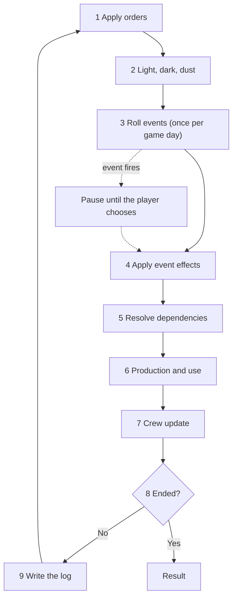

# ORBY 03: GameFlow

*Rules and simulation specification · Document 3 of 7 · Version 1.1 · November 14, 2026 · Hackathon edition*

| | |
|---|---|
| This document owns | Every game rule and number: time and pacing, state, the hourly tick, dependencies, gear, events, difficulty, scoring and endings. |
| Read it if | You are building or tuning the simulation, the balance script, the events or the gear data. |
| It defers to | Science facts (01), screens (04), visuals (05), code structure (06), data shapes (07). |

**How the seven documents stay aligned.** Each fact has one owner. If two documents seem to disagree, the document that owns the topic wins. The decision log, requirements, work packages and risks are in the *ORBY Technical Documentation and Project Plan v1.1*, which is the project plan and is not one of the seven.

## Shared facts (identical in all seven documents)

| Topic | Locked fact | Decision |
|---|---|---|
| Product | ORBY is an educational browser 3D survival game for ages 7 to 12. The mission name is ARTEMIS-III. | D-01 |
| Scenario | Four astronauts, 90 Earth days, lunar south pole. Season 01 is Moon only. Mars is shown locked as Season 02. | D-16 |
| Time | The simulation stores hours since landing. One tick is one game hour, 2,160 ticks per mission. The Moon clock reads DAY X / 90. SOL (24.66 h) is used only for Mars. | D-02 |
| Pacing | A full mission is played in 10 minutes at 1x, which is 3.6 game hours per second. The player gives standing orders. Pause is always available. Speeds are 1x, 1.25x, 1.5x, 1.75x and 2x. The game pauses at every event. | D-04 |
| Dark intervals | Mostly sunlit, with dark intervals by difficulty: Cadet 48 h, Pilot 72 h, Commander 100 h. 100 h = 4 days 4 hours = 4.17 Earth days = 4.06 sols. No 14-day night. | D-03 |
| Difficulty | Cadet (Easy), Pilot (Medium, default), Commander (Hard). | D-09 |
| Gear | Twelve modules (Power 3, Life support 4, Safety 3, Systems 2). Payload cap 1,800 kg. Default load 1,300 kg. All twelve weigh 2,470 kg. Nothing is mandatory. | D-06 |
| Radiation | A hydrogen-rich liner is built into the Regolith Storm Shelter Vault. There is no suit-based radiation weave. | D-07 |
| Reactor | The Kilopower Fission Reactor is labeled planned technology. All its numbers are game values. | D-08 |
| Meters | Four lifelines (Oxygen, Water, Food, Power / heat) feed four summary meters (Life Support, Power, Shielding, Crew Health). | D-05 |
| Power shortage | When power is short, the game switches off the least important loads first: science, then rovers, communications and heating. Life support is the last to go. The keep-alive priority, highest first, is life support, heating, communications, rovers, science. | DR-01 |
| Crew | Four astronauts. Names and roles come from the NASA dataset. Placeholders: Sarah Chen (Flight engineer), Marcus Vance (Medical officer), Elena Rostova (Geologist), Tyler Hayes (Pilot). Each role has a main task and a backup task (03, section 3.4). | D-13 |
| Endings | Mission Complete (tasks done, crew alive), Crew Survived (crew alive at the end) or Try again. Minimum survivors to win is a config value, set to 1. Stars are a game assumption. | D-14 |
| Guidance | A What to do now bar, coach marks, an Explain tooltip on every meter, event cards with cost and risk, and a Help key. | D-15 |
| Architecture | Client-only. No backend, no database, no /api route. Rules live in src/game and never import Three.js or React. Data lives in src/config and public/data. | D-10, D-11 |
| Routes | #/landing, #/menu, #/name, #/explore, #/briefing/1-4, #/gear, #/hangar, #/destination, #/launch, #/outpost, #/hab, #/result, #/leaderboard. | D-12 |
| Labels | Every number is labeled Sourced, Calculated, Unverified or Game assumption. A DATA SOURCE tag shows what comes from the NASA dataset. The baseline is inspired by NASA sources, not NASA data. | D-17 |

## The document set

| # | Document | Owns | Read it if |
|---|---|---|---|
| 01 | Research Paper | The science: findings, planning numbers with confidence labels, events and trade-offs, open verification items. | You need to know where a number or a claim comes from, or you are writing science text or an Explain tooltip. |
| 02 | Briefing | The story of the game for players and judges: what ORBY is, how to play, controls, and the demo script. | You are new to the project, you are writing player-facing text, or you are preparing the demo. |
| 03 | GameFlow | Every game rule and number: time and pacing, state, the hourly tick, dependencies, gear, events, difficulty, scoring and endings. | You are building or tuning the simulation, the balance script, the events or the gear data. |
| 04 | AppFlow | The 13 routes, what each screen shows and does, the copy on each screen, app state and the screen build order. | You are building a screen, the router or the state store. |
| 05 | UXUI Design | Look and feel: tokens, type, components, layouts, the two themes, mockups of the key screens, accessibility and plain-language rules. | You are styling, designing assets, or checking that a screen is readable for ages 7 to 12. |
| 06 | Technical Stack | The stack, the architecture rules, the folder structure, the visual upgrades, testing, the two-day plan and the AI prompts. | You are writing code, setting up the repo, or planning the hackathon hours. |
| 07 | Backend Schema | The logical data model, the dataset onboarding steps, the table-to-client mapping and the optional leaderboard server. | The NASA dataset arrives and you must load, validate or map it. |

## 1. The game in one page

ORBY is a command game. The player prepares a mission, then runs it for 90 Earth days in 10 minutes, then sees how it ended. All rules in this document run in `src/game`, which never imports Three.js or React. The screens, the 3D scenes and the sound only read the state and draw it.

| Phase | What the player does | Rules that apply |
|---|---|---|
| **Prepare** | Picks a difficulty and packs gear (up to 1,800 kg from twelve modules) | Sections 7 and 9 |
| **Launch** | Meets the crew, picks the Moon, watches or skips the launch | No simulation runs. The loadout and difficulty are locked in. |
| **Run the mission** | Gives standing orders, answers events, pauses and changes speed | Sections 2 to 6, 8 and 10 |
| **Finish** | Sees the ending, stars, score and the reason | Section 11 |

**The central loop.** Every game hour the simulation applies the player's orders, moves the clock, checks the light, rolls events, resolves what depends on what, spends and makes resources, updates the crew, and checks whether the mission has ended. That is 2,160 loops per mission. At 1x, 3.6 of them happen each second.

## 2. Time and pacing

### 2.1 The clock

The simulation stores one number: **hours since landing**. One tick is one game hour, so there are 24 ticks per Earth day and 2,160 ticks in a 90-day mission. The interface turns that number into the unit of the destination. On the Moon the clock reads **DAY X / 90**. **SOL** is for Mars only (Season 02).

- DAY = floor(hours ÷ 24) + 1 for the Moon.
- SOL = floor(hours ÷ 24.66) + 1 for Mars.
- `HOURS_PER_DAY = 24` and `HOURS_PER_SOL = 24.66` live in config.

The simulation advances with a **fixed time step and an accumulator**, so results do not depend on the frame rate. Randomness comes from a **seeded generator**, so the same seed and the same choices always give the same run. That makes bugs reproducible and a future Compete mode fair.

### 2.2 Ten minutes, pause and speed

A full mission is played in **10 minutes of mission time at 1x**. At 1x the mission clock runs 600 seconds for 2,160 game hours, which is **3.6 game hours per second**. Pausing, event decisions and the Help screen stop the mission clock, and that time does not count against the 10 minutes.

| Speed | Real time for 90 days | Real time per game day | Longest dark interval, 100 h (Hard) |
|---|---|---|---|
| 1x (default) | 10 min 0 s | 6.7 s | 27.8 s |
| 1.25x | 8 min 0 s | 5.3 s | 22.2 s |
| 1.5x | 6 min 40 s | 4.4 s | 18.5 s |
| 1.75x | 5 min 43 s | 3.8 s | 15.9 s |
| 2x | 5 min 0 s | 3.3 s | 13.9 s |

At 1x the 72-hour Pilot dark interval lasts 20 seconds and the 48-hour Cadet interval lasts 13.3 seconds. The speeds are a config array, so the list can change.

**Rules**

- **Pause** is always available.
- **Speeds** are 1x (default), 1.25x, 1.5x, 1.75x and 2x.
- **Automatic pauses.** The game pauses at every event and decision until the player chooses.
- **Mission timer.** It shows the real time left, 10:00 at the start. At 2x it drops two seconds per real second.

### 2.3 Time and unit conversions

Every duration also shows the other unit in its Explain tooltip.

| Quantity | Value | Label |
|---|---|---|
| Simulation tick | 1 hour, 24 ticks per Earth day | Game design |
| Mars sol | 24 h 39 min 35.244 s, about 24.66 h | Sourced (NASA Mars24) |
| Longest dark interval | 100 h = 4 days 4 hours = 4.17 Earth days | Calculated |
| The same interval in Mars sols | 100 h ÷ 24.66 h = 4.06 sols | Calculated |
| Dark interval by difficulty | Cadet 48 h (2 days), Pilot 72 h (3 days), Commander 100 h (4 days 4 hours) | Game assumption |
| Moon mission length | 90 Earth days = 2,160 h | Scenario |
| Mars mission length (Season 02) | 90 sols = about 2,219 h = about 92.5 Earth days | Calculated |
| Share of the Moon mission spent in the longest dark interval | 100 h ÷ 2,160 h = 4.6% | Calculated |

The HUD shows the next dark period: when it starts and how long it lasts, for example *Dark period in 3 days 6 hours, lasts up to 4 days 4 hours.*

## 3. What the player can do

### 3.1 Standing orders

Each astronaut has one task at a time. The task continues until the player changes it. The player does not end the day.

| Task | What it does | Needs |
|---|---|---|
| **EVA repair** | Clears dust from panels, fixes outside equipment. Costs oxygen, suit energy and crew time. | A working suit and airlock |
| **Power grid** | Keeps generation and the battery in good shape, reduces failures | None |
| **Hydroponics** | Grows fresh food | Hydroponic Growth Chamber (GM-07) |
| **Research** | Earns science points. Rover trips extend the range. | None. A rover (GM-12) extends range. |
| **Rest and recovery** | Restores health, morale and fatigue | None |
| **Storm shelter** | Keeps the astronaut inside the vault and cuts radiation dose | Regolith Storm Shelter Vault (GM-08) for full protection |

The HUD flags an order that needs a second look. Examples: an astronaut is very tired, an astronaut on an EVA when a storm alert starts, or a task that cannot run because the gear is not packed.

### 3.2 Event decisions

The game pauses when an event fires. The event card shows what happened, why it matters, and each option with its cost and its risk in one line. The player must pick an option. Details are in section 8.

### 3.3 Other actions

- **Shelter all crew** during a radiation alert.
- **Change a load** when power is short. The game sheds the least important loads first (DR-01), and the player can switch a load off earlier.
- **Pause, change speed, move the camera, open Help.** These never change the simulation, except that pause and speed change how fast real time passes.

### 3.4 Crew roles and tasks (placeholders, D-13)

The names and roles below are placeholders. The NASA dataset replaces them on hackathon day. A role gives each astronaut a **main task** and a **backup task**. Roles suggest, they do not limit: the player can give any astronaut any of the six tasks in section 3.1.

**Starting orders.** Each astronaut starts the mission on the main task. If the gear for it is not packed, the astronaut starts on the backup task and the HUD says why. With the default load, Marcus starts on Research. Pack the Hydroponic Growth Chamber (GM-07) and he moves to Hydroponics.

| Astronaut | Role | Main task | Backup task | What they do on the Moon | Events where the role matters |
|---|---|---|---|---|---|
| Sarah Chen | Flight engineer | Power grid | EVA repair | Keeps the solar array, the battery and the water recycler running. Plans the battery for each dark period. | EV-03 recycler fault, EV-05 long darkness, EV-07 oxygen generator trips, EV-08 battery critical, EV-13 fission backup |
| Tyler Hayes | Pilot | EVA repair | Research, with rover trips | Goes outside to clean dust off the panels and fix equipment. Drives the rover (GM-12). | EV-01 solar storm during an EVA, EV-02 dust in the airlock, EV-04 dust on the solar panels, EV-10 airlock malfunction |
| Elena Rostova | Geologist | Research | Hydroponics (soil and plant science, needs GM-07) | Collects samples and earns science points. A rover extends her range. | Science is the first load switched off when power is short (DR-01) |
| Marcus Vance | Medical officer | Hydroponics (needs GM-07) | Research | Grows fresh food. Checks the crew's health and radiation dose. | EV-14 crew illness or injury (Medical Kit, GM-10), EV-11 heavy exercise day, EV-06 CO₂ scrubber fails |

**Everyone together.** When a storm alert starts, the whole crew switches to Storm shelter. When someone is tired, the What to do now bar says so, for example "Elena is tired. Give her a rest", and the player sets Rest and recovery.

**Role bonus (not in v1.1).** An optional idea: an astronaut on their main task works a little better, for example about 15% faster. It is not a rule. If the team wants it, add it to the parameter registry as a game assumption and tune it with the balance script.

The data shape for the crew is in document 07, section 7. The hangar dossier is in document 04, section 4.8.

## 4. State model

| Group | Contents |
|---|---|
| **Time** | Hour since landing, day (1 to 90), light phase (sunlit or dark), time to the next change |
| **Resources** | Battery (kWh), solar output (kW), fission output (kW, only if packed), demand (kW), oxygen (kg), water (L), food (kg), CO₂ level, spare parts, medical supplies, dust level on the panels (0 to 1) |
| **Systems** | For power, water recovery, oxygen generation, CO₂ removal, communications, rover and suits: condition (0 to 100) and status (online, degraded, offline) |
| **Crew** | For each astronaut: health, morale, fatigue, radiation dose (mSv), task and status |
| **Hazards** | Habitat integrity, shelter state, active alerts |
| **Mission** | Objectives, science completed, score inputs |
| **Event log** | Every change with its reason. The HUD and the result screen read it. |

The data shapes for these are in document 07, and the screens that show them are in document 04.

## 5. The hourly tick

Every tick runs these nine steps in this order. The order matters, because a fix in step 1 can change what happens in step 5.

1. **Apply the player's actions:** tasks, EVAs, repairs, shelter orders.
2. **Update lighting, dark intervals and dust accumulation.**
3. **Roll new events** with the seeded generator, scaled by difficulty. This step rolls only at hour 0 of each game day (once per day, section 8). The scheduled EV-05 starts with a dark interval. If an event fires, pause.
4. **Apply active event effects.**
5. **Resolve dependencies** in order: power, then water recovery, oxygen generation, CO₂ removal, communications. Reduce output where a requirement is unmet and record why.
6. **Compute production and use** for each resource.
7. **Update crew** health, morale, fatigue and radiation dose.
8. **Check the end conditions:** day 90, the whole crew lost, or a lifeline at zero past the grace period.
9. **Write the log.**

## 6. Lifelines, meters and dependencies

### 6.1 Four lifelines feed four meters (D-05)

The player sees two layers. The four **lifelines** are what the crew needs to live. The four **summary meters** are the overall picture.

| Summary meter | Built from | Shown to the player as |
|---|---|---|
| **Life Support** | Oxygen, CO₂, water, food, cabin pressure and temperature | Oxygen, Water and Food lifelines, plus a CO₂ warning |
| **Power** | Solar and fission generation, battery, demand, heat | The Power / heat lifeline and the grid readout |
| **Shielding** | Shelter readiness, shielding gear, dosimeter alerts, radiation dose | A Shielding gauge and the storm alert |
| **Crew Health** | Per-astronaut health, morale, fatigue and dose | A status LED on each suit and in the crew dock |

**Defeat rule.** Any lifeline at zero for longer than the grace period, or the whole crew lost.

### 6.2 Dependency rules

| ID | Rule | Research |
|---|---|---|
| DR-01 | If power is below demand, the least important loads are shed first: science, then rovers, communications and heating. Life support is shed last. The keep-alive priority, highest first, is life support, heating, communications, rovers, science. | 3.2, 5.3 |
| DR-02 | Water recovery needs power. Without it the recycler pauses and water is drawn from reserves. | 3.3, 3.6 |
| DR-03 | Oxygen generation needs power and water. Low water reduces oxygen output. | 3.3, 3.6 |
| DR-04 | CO₂ removal needs power. If it is offline, CO₂ rises and crew performance and health fall. | 3.3, 3.6 |
| DR-05 | Dust on the panels lowers solar output. An EVA clears it and costs oxygen, suit energy and crew time. | 3.2, 3.4 |
| DR-06 | A radiation alert forces the crew to shelter or accept dose. Sheltering costs power and time. A dosimeter gives earlier warning. | 3.4 |
| DR-07 | Without heating power the cabin cools and crew health falls. | 3.4 |

**How DR-01 is stored.** `load_priority` in the `systems` table is the keep-alive priority: 1 for life support (water recovery, oxygen generation, CO₂ removal), 2 for heating, 3 for communications and 4 for the rover. The game sheds from the highest number down. Science has no system row and is cut first. A system with no priority (power, food production, shelter, medical, suits) is never shed. The earlier drafts listed the order without saying which end is cut first. This document fixes it: the research rule is that life support comes first and mission goals come second.

### 6.3 The four cascades to build first

| Cascade | Chain |
|---|---|
| **Power** | Dust or a long dark interval cuts power, the battery drains, the recycler pauses, oxygen generation slows, water reserves fall, and EVA time is limited. |
| **Water** | A recycler failure speeds up water loss, less water is left for oxygen, and the crew must cut hygiene water or use reserves. |
| **Air** | A scrubber fails during a brownout, CO₂ rises, crew performance and health fall, and the player must divert power from science. |
| **Radiation** | A solar storm during an EVA forces an abort and a shelter stay, which costs science time and shelter resources. |

Each cascade needs one unit test (REQ-03).

### 6.4 Display levels

For the power meter the HUD uses four levels: **high** (all systems normal), **medium** (warning, conserve energy), **low** (turn off optional equipment) and **critical** (activate backup power or risk losing essential systems). These are game mechanics, not NASA safety thresholds. The thresholds are in `resource_types` (`warning_threshold`, `critical_threshold`) and come from config.

## 7. Gear modules (D-06)

The player packs up to **1,800 kg**. Nothing is mandatory. The default load is **1,300 kg**. All twelve modules weigh **2,470 kg**, so the player must choose.

| ID | Module | Category | Mass | Default | Simulation effect | Research link |
|---|---|---|---|---|---|---|
| GM-01 | Deployable Solar Array | Power | 220 kg | Packed | Solar generation (none without it) | 3.2 |
| GM-02 | Solid-State Battery Bank | Power | 200 kg | Packed | Battery capacity | 3.2 |
| GM-03 | Kilopower Fission Reactor | Power | 600 kg | Not packed | Constant output, labeled planned technology (D-08) | 3.2 |
| GM-04 | Urine and Condensate Water Recycler | Life support | 250 kg | Packed | Water recovery (base 85%, upgraded 98%) | 3.3 |
| GM-05 | Water Electrolysis O₂ Generator | Life support | 180 kg | Packed | Oxygen production | 3.3 |
| GM-06 | CO₂ Removal and Reduction Unit | Life support | 160 kg, game assumption | Packed | Removes crew CO₂ and returns part of the oxygen (base 42%). Needs power. Spare filters are consumables (EV-06). Without it CO₂ rises (DR-04). | 3.3, 3.6 |
| GM-07 | Hydroponic Growth Chamber | Life support | 120 kg | Not packed | Food production | 3.5 |
| GM-08 | Regolith Storm Shelter Vault | Safety | 200 kg | Packed | Radiation protection and sheltering, hydrogen-rich liner (D-07) | 3.4 |
| GM-09 | Advanced Dosimeter and Solar Warning Array | Safety | 50 kg | Not packed | Earlier storm warning | 3.4 |
| GM-10 | Medical Kit and Treatment Bay | Safety | 90 kg, game assumption | Packed | Treats illness and injury (EV-14), speeds recovery, slows health loss. Uses medical supplies. | 3.5 |
| GM-11 | Modular Avionics Pump Spare Kit | Systems | 100 kg | Not packed | Faster, more reliable recycler and pump repairs | 3.3 |
| GM-12 | Lunar Rover | Systems | 300 kg, game assumption | Not packed | Extends EVA range. Draws about 500 W while in use. Trips raise dust on panels (EV-04). | 3.2, 3.5 |

**Loadout arithmetic (checked).**

| Loadout | Mass | Fits the 1,800 kg cap? |
|---|---|---|
| Default (the seven packed modules) | 1,300 kg | Yes |
| Default plus the rover | 1,600 kg | Yes |
| Default plus the rover, dosimeter and spare kit | 1,750 kg | Yes |
| Default plus the reactor | 1,900 kg | **No**, 100 kg over |
| Default, swap the solar array for the reactor | 1,680 kg | Yes |
| All twelve | 2,470 kg | No |

That mirrors the research: fission does not depend on sunlight, but it is planned technology (D-08). The 1,800 kg cap, and the masses of the CO₂ unit (160 kg), the medical kit (90 kg) and the rover (300 kg), are game assumptions. They are sized against the existing modules: the CO₂ unit is lighter than the O₂ generator, the medical kit sits between the dosimeter and the spare kit, and the rover is heavier than the recycler but half the reactor. The balance script tunes them.

**Rules**

- **Cap.** Adding a module that would pass 1,800 kg is blocked, and the screen says why in plain words.
- **No soft lock.** If a lifeline has nothing packed, the screen shows a warning and still lets the player continue. The crew then relies on stored reserves.
- **The reactor** is labeled **Planned technology**. All its numbers are game values.
- **The shelter vault** includes a hydrogen-rich liner (D-07). There is no suit-based radiation weave.
- **A module that is not packed** does nothing. Its tasks and events do not appear (for example no Hydroponics task without GM-07, no EV-14 without GM-10).

## 8. Event catalog

Every option carries at least one **cost** and one **risk** (REQ-12). The table below is generated from the seed data in `orby_schema.sql`. All costs and risks are **sample game assumptions** for the balance script to tune. The risk is the chance that the choice goes wrong. The card shows it as a word: **Low** up to 10%, **Medium** up to 30%, **High** above that. Priority uses MoSCoW: **M** must, **S** should, **C** could. "From hour" is the earliest game hour the event can fire.

| ID | Event | Pri. | Needs | From hour | Lasts | Options: cost, then risk |
|---|---|---|---|---|---|---|
| EV-01 | Solar storm warning during an EVA | M | None | 48 h | 6 h | Abort to shelter: 6 crew h, 8 kWh power; Low (5%) Finish the task: 1 crew h; High (60%) Send one astronaut back: 3 crew h; Medium (30%) |
| EV-02 | Lunar dust in the airlock | M | None | 24 h | 2 h | Automatic removal: 4 kWh power; Low (5%) Manual cleaning: 3 crew h; Low (10%) Skip: suit wear; High (35%) |
| EV-03 | Water recycler fails or clogs | M | None | 72 h | 12 h | Repair: 4 crew h, 1 spare part; Medium (15%) Swap a spare cartridge: 2 spare parts; Low (5%) Ration water: −5 morale; Medium (20%) Use reserves: 20 L water; Medium (25%) |
| EV-04 | Dust on solar panels | M | None | 48 h | 24 h | Clean by EVA: 3 crew h, 1.5 kg oxygen; Medium (20%) Wait and conserve: 20 kWh power; Medium (30%) Use backup: 6 h of backup; Low (10%) |
| EV-05 | Long darkness, up to 100 hours | M | None | 120 h | 48, 72 or 100 h (by difficulty) | Reduce heating: −3 °C cabin; Medium (25%) Delay rover use: −5 science; Low (10%) Shed optional loads: −3 morale; Medium (15%) Use backup: 50 kWh battery; Medium (20%) |
| EV-06 | CO₂ scrubber fails | S | CO₂ unit packed (GM-06) | 96 h | 8 h | Swap a spare filter: 1 spare part; Low (5%) Divert power to reboot: 10 kWh power; Medium (20%) Cut activity: −5 science; Medium (25%) |
| EV-07 | Oxygen generator trips | S | None | 96 h | 6 h | Use stored oxygen: 5 kg oxygen; Medium (15%) Reduce EVAs: −5 science; Low (10%) Repair: 4 crew h, 1 spare part; Medium (20%) |
| EV-08 | Battery critical | S | None | 120 h | 12 h | Choose which loads stay on: −3 morale; Medium (15%) Switch to backup: 6 h of backup; Low (10%) Repair: 3 crew h; Medium (25%) |
| EV-14 | Crew illness or injury | S | Medical kit packed (GM-10) | 72 h | 48 h | Treat with the kit: 1 medical supply; Low (10%) Rest and recover: 12 crew h; Medium (20%) Keep working: −10 health; High (50%) |
| EV-09 | Thermal control fails in a cold period | C | None | 120 h | 12 h | Repair: 3 crew h; Medium (20%) Manage power: 10 kWh power; Medium (25%) |
| EV-10 | Airlock malfunction | C | None | 72 h | 6 h | Repair first: 4 crew h; Low (10%) Delay EVAs: −5 science; Low (10%) |
| EV-11 | Heavy exercise day | C | None | 48 h | 24 h | Keep the schedule: +10 fatigue; Medium (30%) Reduce the schedule: −3 science; Low (10%) |
| EV-12 | Communications draw too much power | C | None | 48 h | 12 h | Reduce contact: −3 morale; Low (10%) Keep it: 6 kWh power; Medium (15%) |
| EV-13 | Fission backup available | C | Reactor packed (GM-03) | 120 h | 24 h | Activate backup power: 24 h of backup; Low (10%) Stay on batteries: 30 kWh battery; Medium (20%) |

Mars events (a global dust storm and a clogged MOXIE intake) are deferred to Season 02.

**How events fire.** Events roll **once per game day**, at hour 0 of each day (the base probability in the table is per game day). Each eligible event rolls against its base probability, scaled by the difficulty's event frequency multiplier. An event is eligible when the hour has passed its "From hour" value, its needed gear is packed, and the same event is not already active. An option's cost is spent when it is chosen, and the risk decides the outcome in the same step. The game pauses until the player chooses.

**EV-05 (Long darkness) is scheduled, not rolled.** It fires at the start of a dark interval, so the light schedule and the event always agree. Its length comes from the difficulty: 48, 72 or 100 hours. The sample probability in the table is not used for EV-05.

**Balance item for the team.** If every event were eligible, the sample probabilities add up to about 0.63 events per game day, which is more than 50 event cards in a 10-minute mission. That is too many, because every event pauses the game. The numbers are samples. Tune them with the balance script so a typical mission shows about 6 to 12 event cards (a build default, team to confirm).

## 9. Difficulty (D-09)

One configuration per level sets how hard the mission is. All the multipliers are **sample game assumptions**, tuned by the balance script.

| Setting | Cadet (Easy) | Pilot (Medium, default) | Commander (Hard) |
|---|---|---|---|
| Starting reserves | ×1.25 | ×1.00 | ×0.80 |
| Resource burn | ×0.85 | ×1.00 | ×1.15 |
| Hazard (event) frequency | ×0.7 | ×1.0 | ×1.4 |
| Failure severity | ×0.7 | ×1.0 | ×1.3 |
| Dark interval | 48 h (2 days) | 72 h (3 days) | 100 h (4 days 4 hours) |
| Grace period before defeat | 48 h | 24 h | 12 h |
| Dark interval at 1x | 13.3 s | 20.0 s | 27.8 s |

**Sizing example.** A 10 kW average load needs 480 kWh over the 48-hour Cadet interval, 720 kWh over the 72-hour Pilot interval and 1,000 kWh over the 100-hour Commander interval. The prototype battery holds 500 kWh, or 750 kWh with the upgrade. On Commander a solar-only loadout must therefore shed load (DR-01) or pack the reactor. Battery size, reactor output and demand are tuned together, and the balance script is the check.

## 10. Parameter registry

Every value below is a seed value in `game_parameters` and an adapter parameter. When the NASA dataset arrives, a dataset row can replace a value, and the DATA SOURCE tag then shows where it came from. Labels follow the research paper.

| Code | Value | Unit | Label | Note |
|---|---|---|---|---|
| `hours_per_day` | 24 | h | Calculated | One Earth day. 1 tick = 1 hour, 24 ticks per day. |
| `hours_per_sol` | 24.66 | h | Sourced | Mars sol is 24 h 39 min 35.244 s (NASA Mars24). |
| `mission_days` | 90 | days | Game assumption | Scenario: 90 Earth days on the Moon = 2,160 h. |
| `mission_clock_seconds` | 600 | s | Game assumption | D-04: a full mission is played in 10 minutes at 1x. Paused time does not count. |
| `crew_size` | 4 | people | Game assumption | D-13: four astronauts per mission. |
| `win_min_survivors` | 1 | people | Game assumption | D-14: minimum survivors needed to win. Config value set by the team. |
| `payload_cap_kg` | 1,800 | kg | Game assumption | D-06: payload cap decided by the team. |
| `oxygen_kg_per_person_day` | 0.84 | kg | Sourced | Nominal oxygen use per person per day. |
| `oxygen_kg_per_person_day_high` | 1.2 | kg | Game assumption | High exertion value from the prototype. |
| `food_kg_per_person_day` | 0.62 | kg | Sourced | Food solids per person per day. State the kg to ration conversion in the UI. |
| `water_drinking_kg_per_person_day` | 1.62 | kg | Sourced | Drinking water per person per day. |
| `water_min_allocation_l` | 2.5 | L | Sourced | Minimum water allocation per person per day. |
| `water_recovery_base` | 0.85 | ratio | Game assumption | Urine processor about 85% (ISS). Base recycler. |
| `water_recovery_upgraded` | 0.98 | ratio | Game assumption | ISS total water recovery about 98%. Upgraded recycler. |
| `o2_recovery_base` | 0.42 | ratio | Game assumption | Oxygen recovered from CO2 today is about 42% (dated). Provided by the CO2 unit. |
| `o2_recovery_upgraded` | 0.75 | ratio | Game assumption | NASA goal is above 75%. |
| `solar_output_kw` | 30 | kW | Game assumption | Prototype value when sunlit. Tune with demand. |
| `battery_kwh` | 500 | kWh | Game assumption | Prototype value. 750 kWh with the upgrade. |
| `battery_kwh_upgraded` | 750 | kWh | Game assumption | Prototype value with the upgrade. |
| `fission_output_kw` | 12 | kW | Game assumption | Planned technology (D-08). NASA target is at least 40 kW; these are game values. |
| `fission_upgrade_kw` | 6 | kW | Game assumption | Planned technology. Added output with the upgrade. |
| `rover_power_kw` | 0.5 | kW | Sourced | About 500 W each while in use (NASA slide). |
| `life_support_power_kw_low` | 1 | kW | Unverified | About 1 to 3 kW. Verify before use (action A-05). |
| `life_support_power_kw_high` | 3 | kW | Unverified | About 1 to 3 kW. Verify before use (action A-05). |
| `co2_kg_per_person_day` | 1 | kg | Unverified | About 1 kg. Verify before use (action A-05). |
| `surface_temp_min_c` | -173 | C | Sourced | Lunar surface range, low end. |
| `surface_temp_max_c` | 127 | C | Sourced | Lunar surface range, high end (127 to 130). |
| `cabin_temp_min_c` | 20 | C | Sourced | Comfortable cabin band, low end. |
| `cabin_temp_max_c` | 25 | C | Sourced | Comfortable cabin band, high end. |
| `comm_delay_s` | 1.3 | s | Sourced | Earth-Moon one-way delay. Optional radio flavor. |

**Planning checks.** Four crew for 90 days use about 302 kg of oxygen (0.84 × 4 × 90), 223 kg of food (0.62 × 4 × 90) and 583 kg of drinking water (1.62 × 4 × 90) before any recycling. Four crew use about 3.36 kg of oxygen and 2.48 kg of food per day. A balance test checks these numbers.

**Values not in the registry yet.** Habitat power (20 to 50 kW at full scale is sourced, and the game scale must be chosen and documented) and the heating power draw. The life-support power draw (1 to 3 kW) and the CO₂ rate (about 1 kg per person per day) are **Unverified** and must be checked before use (action A-05).

## 11. Scoring, endings and stars (D-14)

**Endings**

| Ending | Rule |
|---|---|
| **Mission Complete** | The mission tasks (objectives) are done and the crew is alive at the end. |
| **Crew Survived** | The crew is alive at the end, but not every task is done. |
| **Try again** | The whole crew is lost, or a lifeline stays at zero past the grace period. |

The minimum number of survivors needed to win is a config value, `win_min_survivors`, set to 1 by the team.

**Stars (game assumption).** Three stars for tasks done with all four astronauts alive. Two for all four alive. One for at least one alive. Try again gives none.

**Score.** The score has five parts: crew survival, crew health, resource margin, science completed and objectives achieved. The weights are tunable game assumptions.

**Try again screen.** It gives a plain reason from the event log (for example *Power ran out during the dark period, so the recycler stopped*), one thing to try next time, and a Try again button. Every win screen says what saved the crew.

## 12. What to do now hints

The **What to do now** bar shows one line. The game checks the conditions below in order and shows the first one that is true. The words are plain, and the same wording also appears on the Explain tooltips (document 05 has the language rules, and document 04 shows where the bar sits).

| Order | When | The bar says (example) |
|---|---|---|
| 1 | A radiation alert is active and crew are outside | A storm is coming. Bring everyone inside. |
| 2 | An event is waiting | Something happened. Read the card and choose. |
| 3 | A lifeline is at or below its critical threshold | Power is very low. Turn off the rover or switch to backup. |
| 4 | A dark interval starts within 24 hours and the battery is below the warning level | Dark period soon. Charge the battery first. |
| 5 | Dust is high on the panels | Dust is blocking the sun. Send an EVA to clean the panels. |
| 6 | An astronaut is very tired or has no task | Marcus is tired. Give him a rest. |
| 7 | None of the above | All is well. Keep an eye on the meters. |

The first example uses a placeholder name. The conditions and the order are a build default for the team to tune.

## 13. Balance, tests and determinism

- **Determinism.** The same seed and the same choices produce the same run. A unit test runs a fixed seed twice and compares the event logs.
- **Clock test.** 600 s at 1x equals 2,160 ticks. 300 s at 2x equals 2,160 ticks. Paused time is not counted.
- **Dependency tests.** One unit test per cascade in section 6.3, and one per rule DR-01 to DR-07.
- **Dark interval test.** A dark interval of 100 hours runs for 100 ticks. Dust lowers solar output, and an EVA restores it.
- **Gear tests.** The cap blocks an over-cap load. Removing the CO₂ unit raises CO₂ and lowers health. A rover raises dust and drains the battery.
- **Event data lint.** No option may lack a cost or a risk (REQ-12). The database also enforces this.
- **Ending tests.** One unit test per ending condition in section 11.
- **Balance script.** `scripts/balance.ts` plays 90 days (2,160 ticks) over many seeds on all three difficulty levels with three simple bots: idle, sensible and reckless. It prints the survival rate, the median failure day and the top failure causes. Targets (tunable, team decision): at least one loadout within the 1,800 kg cap survives 90 days with sensible orders; a sensible bot survives on Commander in most seeds; an idle crew fails on Commander; a reckless bot scores clearly lower than a sensible one; and a full mission takes 600 s at 1x and 300 s at 2x. The script exits with an error if a target is missed.

## 14. Requirements covered

| Requirement | Where it is built in this document |
|---|---|
| REQ-01, REQ-22 (command game, ten minutes, pause, speeds) | Sections 2 and 3 |
| REQ-02 (four meters) | Section 6.1 |
| REQ-03, REQ-07, REQ-20 (dependencies, CO₂) | Sections 6.2 and 6.3 |
| REQ-04, REQ-05 (needs, recycling) | Section 10 |
| REQ-06 (darkness, dust) | Sections 2.3, 6.2 and 9 |
| REQ-08, REQ-09, REQ-17 (storm, dust, illness) | Section 8 |
| REQ-10, REQ-11 (shelter liner, reactor label) | Section 7 |
| REQ-12 (cost and risk on every option) | Section 8 |
| REQ-16 (endings and stars) | Section 11 |
| REQ-19 (rover) | Sections 7 and 8 |
| REQ-21 (guidance) | Section 12 |

The full requirements table is in the *ORBY Technical Documentation and Project Plan v1.1*.
