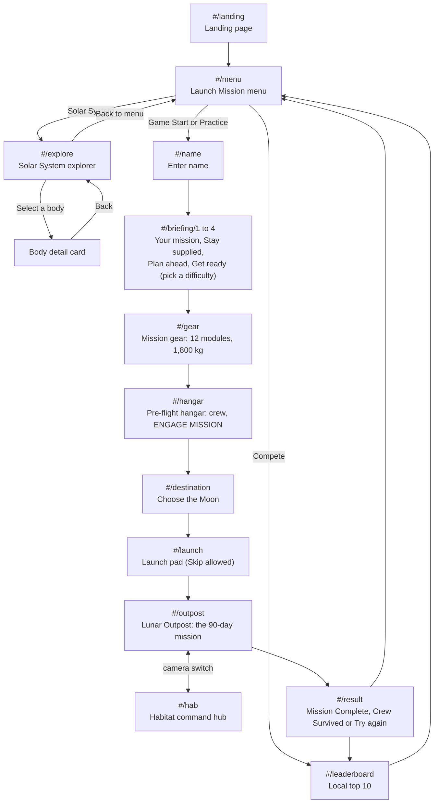

# ORBY 04: AppFlow

*Screens, routes and behavior · Document 4 of 7 · Version 1.1 · November 14, 2026 · Hackathon edition*

| | |
|---|---|
| This document owns | The 13 routes, what each screen shows and does, the copy on each screen, app state and the screen build order. |
| Read it if | You are building a screen, the router or the state store. |
| It defers to | Rules and numbers (03), visual design (05), code structure (06), data (07). |

**How the seven documents stay aligned.** Each fact has one owner. If two documents seem to disagree, the document that owns the topic wins. The decision log, requirements, work packages and risks are in the *ORBY Technical Documentation and Project Plan v1.1*, which is the project plan and is not one of the seven.

## Shared facts (identical in all seven documents)

| Topic | Locked fact | Decision |
|---|---|---|
| Product | ORBY is an educational browser 3D survival game for ages 7 to 12. The mission name is ARTEMIS-III. | D-01 |
| Scenario | Four astronauts, 90 Earth days, lunar south pole. Season 01 is Moon only. Mars is shown locked as Season 02. | D-16 |
| Time | The simulation stores hours since landing. One tick is one game hour, 2,160 ticks per mission. The Moon clock reads DAY X / 90. SOL (24.66 h) is used only for Mars. | D-02 |
| Pacing | A full mission is played in 10 minutes at 1x, which is 3.6 game hours per second. The player gives standing orders. Pause is always available. Speeds are 1x, 1.25x, 1.5x, 1.75x and 2x. The game pauses at every event. | D-04 |
| Dark intervals | Mostly sunlit, with dark intervals by difficulty: Cadet 48 h, Pilot 72 h, Commander 100 h. 100 h = 4 days 4 hours = 4.17 Earth days = 4.06 sols. No 14-day night. | D-03 |
| Difficulty | Cadet (Easy), Pilot (Medium, default), Commander (Hard). | D-09 |
| Gear | Twelve modules (Power 3, Life support 4, Safety 3, Systems 2). Payload cap 1,800 kg. Default load 1,300 kg. All twelve weigh 2,470 kg. Nothing is mandatory. | D-06 |
| Radiation | A hydrogen-rich liner is built into the Regolith Storm Shelter Vault. There is no suit-based radiation weave. | D-07 |
| Reactor | The Kilopower Fission Reactor is labeled planned technology. All its numbers are game values. | D-08 |
| Meters | Four lifelines (Oxygen, Water, Food, Power / heat) feed four summary meters (Life Support, Power, Shielding, Crew Health). | D-05 |
| Power shortage | When power is short, the game switches off the least important loads first: science, then rovers, communications and heating. Life support is the last to go. The keep-alive priority, highest first, is life support, heating, communications, rovers, science. | DR-01 |
| Crew | Four astronauts. Names and roles come from the NASA dataset. Placeholders: Sarah Chen (Flight engineer), Marcus Vance (Medical officer), Elena Rostova (Geologist), Tyler Hayes (Pilot). Each role has a main task and a backup task (03, section 3.4). | D-13 |
| Endings | Mission Complete (tasks done, crew alive), Crew Survived (crew alive at the end) or Try again. Minimum survivors to win is a config value, set to 1. Stars are a game assumption. | D-14 |
| Guidance | A What to do now bar, coach marks, an Explain tooltip on every meter, event cards with cost and risk, and a Help key. | D-15 |
| Architecture | Client-only. No backend, no database, no /api route. Rules live in src/game and never import Three.js or React. Data lives in src/config and public/data. | D-10, D-11 |
| Routes | #/landing, #/menu, #/name, #/explore, #/briefing/1-4, #/gear, #/hangar, #/destination, #/launch, #/outpost, #/hab, #/result, #/leaderboard. | D-12 |
| Labels | Every number is labeled Sourced, Calculated, Unverified or Game assumption. A DATA SOURCE tag shows what comes from the NASA dataset. The baseline is inspired by NASA sources, not NASA data. | D-17 |

## The document set

| # | Document | Owns | Read it if |
|---|---|---|---|
| 01 | Research Paper | The science: findings, planning numbers with confidence labels, events and trade-offs, open verification items. | You need to know where a number or a claim comes from, or you are writing science text or an Explain tooltip. |
| 02 | Briefing | The story of the game for players and judges: what ORBY is, how to play, controls, and the demo script. | You are new to the project, you are writing player-facing text, or you are preparing the demo. |
| 03 | GameFlow | Every game rule and number: time and pacing, state, the hourly tick, dependencies, gear, events, difficulty, scoring and endings. | You are building or tuning the simulation, the balance script, the events or the gear data. |
| 04 | AppFlow | The 13 routes, what each screen shows and does, the copy on each screen, app state and the screen build order. | You are building a screen, the router or the state store. |
| 05 | UXUI Design | Look and feel: tokens, type, components, layouts, the two themes, mockups of the key screens, accessibility and plain-language rules. | You are styling, designing assets, or checking that a screen is readable for ages 7 to 12. |
| 06 | Technical Stack | The stack, the architecture rules, the folder structure, the visual upgrades, testing, the two-day plan and the AI prompts. | You are writing code, setting up the repo, or planning the hackathon hours. |
| 07 | Backend Schema | The logical data model, the dataset onboarding steps, the table-to-client mapping and the optional leaderboard server. | The NASA dataset arrives and you must load, validate or map it. |

## 1. Purpose and scope

This document describes every screen in ORBY, how the screens connect, what the player can do on each one, and the words on them. It is the build spec for the front end. It does not define game rules (document 03), colors or layouts (document 05), code structure (document 06) or data shapes (document 07). Where a screen shows a number or a rule, it points to the document that owns it.

A full mission takes **10 minutes** at normal speed. The player wins by finishing the mission tasks or by keeping the crew alive until the end. Otherwise the game shows **Try again** with a plain explanation. Anything marked *tunable* is a starting value to adjust.

**13 routes, 16 screens.** The router has 13 route patterns. The briefing is one route with a step from 1 to 4, so it makes four screens. Navigation is by hash route and by one typed screen state machine, and there is no router library.

## 2. Flow at a glance

Back buttons on the briefing screens move back one step. Browser Back and Forward work. Refreshing a pre-mission route restores it. Refreshing in the middle of a mission offers **Resume** or **Menu** (section 5). A feature that is not built shows a **Coming in Season 02** toast, never a dead button.

## 3. Screen inventory

| # | Route | Screen | Purpose | Goes to |
|---|---|---|---|---|
| 1 | `#/landing` | Landing page | Welcome and call to action | #/menu |
| 2 | `#/menu` | Launch Mission menu | Game Start, Practice, Solar System, Compete | #/name, #/explore, #/leaderboard |
| 3 | `#/name` | Enter Name | Callsign, 2 to 16 characters | #/briefing/1 |
| 4 | `#/explore` | Solar System explorer and body cards | Learn about the planets | #/menu |
| 5 to 8 | `#/briefing/1 to 4` | Your mission, Stay supplied, Plan ahead, Get ready | Rules and difficulty | #/gear |
| 9 | `#/gear` | Mission gear | Choose up to 1,800 kg of equipment | #/hangar |
| 10 | `#/hangar` | Pre-flight hangar | Meet the four astronauts, ENGAGE MISSION | #/destination |
| 11 | `#/destination` | Destination | Select the Moon and confirm | #/launch |
| 12 | `#/launch` | Launch pad cinematic | Liftoff, with Skip | #/outpost |
| 13 | `#/outpost` | Lunar Outpost | The 90-day mission | #/hab, #/result |
| 14 | `#/hab` | Habitat command hub | Crew and systems from inside | #/outpost |
| 15 | `#/result` | Result | Mission Complete, Crew Survived or Try again | #/leaderboard, #/menu |
| 16 | `#/leaderboard` | Leaderboard | Local top 10 | #/menu |

The viewport hotkeys 1 to 5 from the older build work only with `?dev=1` (D-12). The Figma frames should be renamed to match this table (action A-11), for example "09 Gear" and "13 Outpost HUD".

## 4. Screen-by-screen spec

### 4.1 Landing page (`#/landing`)

*Mockup: UXUI Design (document 05), Figure 1.*

- **Look:** dark space background, a purple rocket with a flame in the center, the headline **WELCOME TO ORBY**, a short supporting line, and two small decorative sprites.
- **Copy:** "Command a small crew. Keep oxygen, water, food and power above zero, and bring everyone home."
- **Top bar:** ORBY logo at left. Links **Missions**, **Learn**, **Solar System**, and a **Sign in** button at right. Season 01 has no accounts, so Sign in and any link without a screen show the **Coming in Season 02** toast. A link that has a screen (Solar System goes to `#/explore`) works.
- **Primary action:** the yellow button **Get started** goes to `#/menu`.
- **Build notes:** simple and light. The rocket has a gentle float and flame animation.

### 4.2 Launch Mission menu (`#/menu`)

*Mockup: UXUI Design (document 05), Figure 2.*

- **Look:** a retro pixel-style menu over a purple space scene with planets, a rocket launching at right, a waving astronaut at lower left and a gray lunar ground strip.
- **Title:** **Launch Mission**.
- **Buttons:**
  - **Game Start:** goes to `#/name`.
  - **Practice:** the same flow, with every coach mark and hint switched on. Use a fixed gentle seed. The result is not saved to the leaderboard.
  - **Solar System:** goes to `#/explore`.
  - **Compete:** goes to `#/leaderboard`, where the player sees the local top 10 and can start a seeded run. A shared leaderboard is a stretch goal.
- **Profile chip:** top right, shows the callsign and opens the local profile (best stars, missions played). The three small counters and the heart bar from the prototype are decorative: leave them out, or show Missions played, Best stars and Crew saved from the local profile.

### 4.3 Enter Name (`#/name`)

- **Look:** the same pixel-style scene. A label **ENTER NAME:**, a text field, and a confirm button. Back at bottom left.
- **Rules:** callsign of 2 to 16 characters. Store it in the local profile (`orby.profile.v1`) for the whole session.
- **Goes to:** `#/briefing/1`.

### 4.4 Solar System explorer (`#/explore`)

- **Look:** a dark orbital view with the Sun in the center, planets on orbit rings, a body selector and speed and zoom controls at the top right, and **Back** at top left.
- **Actions:** orbit, zoom, change speed, click a body to open its detail card.
- **Goes to:** a body detail card, or back to `#/menu`.
- **Build notes:** stylized, with scaled sizes. Use real orbit and distance data. Mars and the other planets can be browsed, but only the Moon can be chosen as a destination, and Mars shows as **locked, Season 02**.

### 4.5 Body detail card

- **Look:** a left panel slides in with the body name, a short description, four fact tiles and one highlighted callout. A **Back to solar system** button sits at the bottom and a close button at the top.
- **Data per body:** name, type, description, key numbers (size, mass, distance, temperature, orbit period), and a **mission relevance** note that links the body to the game.
- **Length of day:** where it applies, show both units. For example, the Moon shows 24-hour days, and Mars shows a sol of 24 h 39 min 35 s (24.66 h).
- **Build notes:** every body has a card, driven by `public/data/bodies.json`. Missing facts show "Data coming" instead of a blank tile. Add bodies by adding data, not code.

### 4.6 Briefing (`#/briefing/1` to `4`)

*Mockup: UXUI Design (document 05), Figure 3 shows step 4.*

All four steps share one card layout: **Step X of 4** at top left, four progress tabs at top right (**Your mission, Stay supplied, Plan ahead, Get ready**), a headline, content, step dots at the bottom, and **Back** and **Next** buttons. Use short sentences and simple words (D-15).

**Step 1: Your mission.** Eyebrow **WELCOME ABOARD**. Headline: "Keep your crew alive for 90 days." Body: "Help 4 astronauts live at the Moon's south pole." Stat tiles: **4 Astronauts**, **90 Days**, **South pole**. A photo of the crew with the badge **MOON SOUTH POLE**. Add one line: "A full mission takes about 10 minutes."

**Step 2: Stay supplied.** Eyebrow **YOUR FOUR LIFELINES**. Headline: "Keep every resource above zero." Four cards, each with an icon, a name, a one-line description and an **Explain** button:

| Card | Text |
|---|---|
| Oxygen | Air to breathe. |
| Water | Drinking water. |
| Food | Meals for the crew. |
| Power / heat | Energy and warmth. |

Footnote: "Four resources. One rule: don't let any run out."

**Step 3: Plan ahead.** Eyebrow **SMALL PROBLEMS CAN GROW**. Headline: "Plan ahead. Stay powered." A three-box chain with arrows:

1. Dust covers panels. Less sunlight means less power.
2. The recycler stops. Low power pauses recycling.
3. Backup water runs low. The crew uses its reserves.

A strip **BE PREPARED, before you go:** "Carry a water recycler." and "Charge batteries before a dark period." A second tip explains dark periods: "At the south pole the Sun can disappear for up to 100 hours, which is 4 days 4 hours."

**Step 4: Get ready.** Eyebrow **YOU'VE GOT THE BASICS**. Headline: "Pick a difficulty." Three selectable cards in the same style, with the plain label beside each name:

| Card | Label | Text | Dark periods |
|---|---|---|---|
| Cadet | Easy | Forgiving. Fewer hazards. | 48 hours (2 days) |
| **Pilot** (default) | Medium | Balanced. A fair challenge. | 72 hours (3 days) |
| Commander | Hard | Tougher hazards. Less room for mistakes. | 100 hours (4 days 4 hours) |

Primary button **Pack Gear** goes to `#/gear`. **State saved:** the difficulty. Difficulty changes starting reserves, resource burn, hazard frequency, failure severity, the dark-period length and the grace period before defeat (D-03, D-09). The multipliers are in document 03, section 9, and are tunable.

### 4.7 Mission gear (`#/gear`)

*Mockup: UXUI Design (document 05), Figure 4.*

- **Look:** headline **Choose your mission gear.** A left sidebar of categories, a grid of gear cards, and a **payload meter** at top right: **MASS 1,300 / 1,800 kg** at the start.
- **Categories:** All gear 12, Power 3, Life support 4, Safety 3, Systems 2.
- **Each card:** a 3D-rendered or illustrated image, name, mass, one plain line about what it does, a data label chip (**Game assumption**, or **Planned technology** on the reactor), and an **Add / Added** button.
- **Starting loadout:** the seven modules marked Packed below, 1,300 kg. The player can swap items.
- **Rules:**
  - Block adding an item if the total would pass **1,800 kg**. Say why in plain words: "This is too heavy. Take something out first."
  - Gear never soft-locks. If a lifeline has nothing packed (power, water, oxygen or food), show a warning ("No water recycler. Your crew will rely on stored water") but allow **Continue to launch**.
  - The **Kilopower Fission Reactor** carries a **Planned technology** tag (D-08).
  - The **Regolith Storm Shelter Vault** shows "hydrogen-rich liner" in its description (D-07).
- **Goes to:** `#/hangar`.

| Module | Category | Mass | Default | What it says on the card |
|---|---|---|---|---|
| Deployable Solar Array | Power | 220 kg | Packed | Turns sunlight into power. |
| Solid-State Battery Bank | Power | 200 kg | Packed | Stores power for the dark periods. |
| Kilopower Fission Reactor | Power | 600 kg | Not packed | Makes power day and night. Planned technology. |
| Urine and Condensate Water Recycler | Life support | 250 kg | Packed | Recovers most of the water the crew uses. |
| Water Electrolysis O₂ Generator | Life support | 180 kg | Packed | Makes oxygen from water. |
| CO₂ Removal and Reduction Unit | Life support | 160 kg | Packed | Cleans the air and returns some oxygen. |
| Hydroponic Growth Chamber | Life support | 120 kg | Not packed | Grows fresh food. |
| Regolith Storm Shelter Vault | Safety | 200 kg | Packed | A radiation shelter with a hydrogen-rich liner. |
| Advanced Dosimeter and Solar Warning Array | Safety | 50 kg | Not packed | Warns about solar storms earlier. |
| Medical Kit and Treatment Bay | Safety | 90 kg | Packed | Treats illness and injury. |
| Modular Avionics Pump Spare Kit | Systems | 100 kg | Not packed | Speeds up recycler and pump repairs. |
| Lunar Rover | Systems | 300 kg | Not packed | Goes farther for science. Uses about 500 W. |

All twelve weigh 2,470 kg, so the player must choose. With the 1,800 kg cap a rover fits (1,600 kg) and the reactor does not (1,900 kg); swapping the solar array for the reactor gives 1,680 kg. The masses of the CO₂ unit, medical kit and rover, and the 1,800 kg cap, are game assumptions.

### 4.8 Pre-flight hangar (`#/hangar`)

*Mockup: UXUI Design (document 05), Figure 5.*

- **Look:** a 3D hangar with four astronauts on glowing pedestals around a central pad, a yellow-and-black hazard stripe on the floor.
- **Crew:** four astronauts. Names and roles come from the NASA dataset when it is available (D-13). Until then use the placeholders **Sarah Chen, Marcus Vance, Elena Rostova** and **Tyler Hayes**. Click an astronaut to open a short dossier (name, role, health, one fact).
- **Pre-flight HUD:** mission name (**ARTEMIS-III**), a **T-minus** or phase label, loadout summary, payload, and a mute button. No day counter and no live telemetry yet.
- **Primary action:** the lit **ENGAGE MISSION** button goes to `#/destination`.

### 4.9 Destination (`#/destination`)

- **Look:** the Solar System in destination mode. The Moon pulses. Mars is shown locked: "Season 02".
- **Actions:** select the Moon, then confirm. A short camera dive leads to the launch pad.
- **Goes to:** `#/launch`.

### 4.10 Launch pad (`#/launch`)

- **Look:** a rocket on the pad with a service tower. A short cinematic: the arm swings away, engines ignite, liftoff. Pre-flight HUD stays.
- **Actions:** a **Skip** button is always visible. The cinematic ends on its own.
- **Goes to:** `#/outpost`, with a short visor-boot animation.

### 4.11 Lunar Outpost (`#/outpost`) and Habitat (`#/hab`)

*Mockup: UXUI Design (document 05), Figure 6 shows the visor HUD and Figure 7 shows an event card over it.*

This is the 90-day mission. It uses the **visor HUD**.

- **Scene:** lunar surface with a white dome habitat, solar panels, and low-poly orange-suited astronauts. `#/hab` is the same mission from inside the command hub, with the same HUD.
- **Visor HUD parts:**
  - **DAY X / 90** and the light phase (sunlit or dark). A line shows the next dark period, for example "Dark period in 3 days 6 hours, lasts up to 4 days 4 hours."
  - **Four summary meters:** Life Support, Power, Shielding, Crew Health. Each has an **Explain** button.
  - **Four lifelines:** Oxygen, Water, Food, Power / heat, with bars and a LOW tag when needed.
  - **Power grid:** solar output, fission output (if packed), demand, and battery.
  - **Crew dock:** one card per astronaut with a status LED, name, role, health and current task. Click one to change the task.
  - **Event banner:** appears when something happens, and the game pauses.
  - **Mission timer:** shows mission time left, **10:00** at the start. At 2x it drops two seconds per real second.
  - **Pause and speed:** always visible. Speeds are 1x (default), 1.25x, 1.5x, 1.75x and 2x. Paused time does not count.
  - **What to do now bar:** one line with the most useful next step, for example "Power is low. Turn off the rover."
  - **DATA SOURCE tag:** shows whether a value is NASA data or the game baseline.
  - **Camera controls:** a small direction pad and zoom, plus mouse drag and wheel.
  - **Help:** a **[?]** button and the **?** key reopen the briefing and a controls guide. They work while paused.
- **Standing orders:** the player gives each astronaut a task that continues day after day (EVA repair, hydroponics, power grid, research, rest, or storm shelter). The HUD flags an order that needs review, for example a tired astronaut. There is no "end the day" button.
- **Events:** EV-01 to EV-14 (document 03, section 8). The game pauses at every event. An **event card** shows what happened, why it matters, and each choice with its cost and risk in one line.
- **First-time help:** coach marks the first time the player meets the meters, the crew dock, pause and speed, and event cards.
- **Goes to:** `#/result` when the mission ends.

### 4.12 Result (`#/result`)

*Mockup: UXUI Design (document 05), Figure 8 shows Mission Complete and Figure 9 shows Try again.*

- **Mission Complete:** the mission tasks are finished and the crew is alive.
- **Crew Survived:** the crew is alive at the end, but not every task is done.
- **Try again:** the crew is lost, or a lifeline stayed at zero past the grace period. Show a plain reason from the event log ("Power ran out during the dark period, so the recycler stopped"), **one thing to try next time**, and a **Try again** button.
- **Stars (game assumption):** three for tasks done with all four astronauts alive, two for all four alive, one for at least one alive.
- **Also shown:** the five-part score (crew survival, crew health, resource margin, science completed, objectives), a short chart of the four lifelines over the mission, and the real NASA fact that matches the main event of the run.
- **Goes to:** `#/leaderboard` or `#/menu`.

### 4.13 Leaderboard (`#/leaderboard`)

- The local top 10 per mode (callsign, difficulty, stars, score). Season 01 stores it on the device. A server leaderboard is a stretch goal.

## 5. Behavior shared by all screens

These rules apply on every screen. Items marked *build default* are choices made so the build is not blocked, and the team can change them.

- **Back and Forward.** Browser Back and Forward follow the route history. The briefing Back button moves one step back.
- **Resume.** The game saves the seed, difficulty, loadout and the player's actions to `orby.run.v1` once per game day. Because the rules are deterministic, a refresh in the middle of a mission can rebuild the same state. On reload the player sees **Resume** or **Menu**. *Build default.*
- **Toast.** Any control without a screen shows **Coming in Season 02**. A button never does nothing.
- **Loading.** 3D scenes load when needed. A short progress screen shows while a scene loads, with the line "Getting your mission ready."
- **No 3D.** If WebGL2 is not available, show "This browser cannot show 3D. Try a recent Chrome, Edge, Firefox or Safari." The explorer and the briefing text stay readable. *Build default.*
- **Dataset.** If the NASA dataset is missing or a file is invalid, the game runs on the baseline and never crashes. `?debug=1` lists every parameter and its source (document 07).
- **Sound.** Sound starts after the first click, because browsers block autoplay. The mute choice (**M**) is remembered across screens.
- **Motion.** The game respects the device's reduced-motion setting. Cinematics get shorter and flashing is turned off.
- **Pause.** Help, the event card and any dialog stop the mission clock. A paused mission shows a clear **Paused** label.
- **Practice mode.** The same flow as Game Start, with every coach mark and hint on, a fixed gentle seed, and no leaderboard entry. *Build default.*
- **Responsive.** Desktop first, then tablet and phone. The menu, briefing, gear and result screens must work at phone width. The 3D mission needs a tablet or larger for a good experience. Tap targets are at least 44 px.
- **Guidance.** Short sentences, familiar words, one idea per message. Science terms are explained the first time. The **What to do now** bar, coach marks and **Explain** tooltips are on every game screen (D-15). The wording rules are in document 05, and the hint order is in document 03, section 12.

## 6. App state

Keep it in one store so it is easy to save, test and display. Rules live in `src/game` and never import Three.js or React.

- **Player (profile):** callsign, difficulty, best scores. Saved in localStorage as `orby.profile.v1`.
- **Saved run:** seed, difficulty, loadout and the player's actions, saved once per game day as `orby.run.v1` so a refresh can resume (section 5).
- **Navigation:** current route, briefing step (1 to 4).
- **Loadout:** selected modules, total mass, cap (1,800 kg), warnings.
- **Clock:** **hours since landing** (0 to 2,160), paused flag, speed (1, 1.25, 1.5, 1.75 or 2), mission seconds left. Day on the Moon is `floor(hours / 24) + 1`. Sol on Mars is `floor(hours / 24.66) + 1`.
- **Mission:** seed, crew list (health, morale, fatigue, dose, task), resources (oxygen, water, food, power, heat, CO₂, spare parts, medical supplies), system condition and status, active events, event log with reasons, score inputs.
- **Solar system:** selected body, speed, zoom.
- **Settings:** mute, show hints, debug (`?debug=1`).

## 7. Build order

**Stack (summary).** React 19, TypeScript, Vite, Tailwind v4, a custom Three.js engine, procedural Web Audio, with the planned upgrades (postprocessing, GLB models, seeded random, fixed time step). Client-only: no backend is needed (D-10). All content (bodies, gear, difficulty, events, crew, objectives) lives in data files in `public/data` and `src/config`. See document 06.

**Build order:**

- **B1.** App shell, hash routes, the screen state machine and the profile store.
- **B2.** Landing page, Launch Mission menu and Enter Name.
- **B3.** Briefing steps 1 to 4 with Back and Next and the three difficulty cards.
- **B4.** Mission gear with the 12 modules, the payload meter and the lifeline warnings.
- **B5.** Solar System explorer, body cards and destination mode.
- **B6.** Hangar, destination and launch pad scenes with the pre-flight HUD.
- **B7.** Simulation core in `src/game`: hourly tick, dependencies, difficulty, seeded events, and the balance script.
- **B8.** Visor HUD with pause, speed, hints and Explain tooltips, fed from the store.
- **B9.** Outpost and habitat scenes, standing orders and event cards.
- **B10.** Result screens, stars and the local leaderboard.
- **B11.** Dataset adapter, Practice and Compete polish, accessibility and QA.

Build and test one step at a time. Do not move on until the previous step runs.

## 8. Starter prompt for the AI coding tool

Copy the text below, then attach all seven documents after it.

> You are helping me build a web game called ORBY from the attached seven documents. Read all of them before writing code. Follow the build order in document 04, section 7, and start with B1 only. Use React with TypeScript. Keep all game state in one store, keep game rules in `src/game` and never import Three.js or React there, and put all tunable numbers and content (solar system bodies, gear modules, difficulty levels, events, crew) in data files. The game is client-only: no backend and no /api route. Match the screen layouts and wording in document 04, and the colors, type and components in document 05. Use the twelve gear modules, the 1,800 kg cap, the three difficulty levels and the 10-minute mission clock exactly as written. Use DAY for the Moon and SOL only for Mars. If anything is unclear, choose a sensible default, add a TODO comment, and list these items for me at the end. Show me how to run the project, and wait for my confirmation before moving to the next step.

## 9. Resolved questions and what is still open

| Earlier question | Answer |
|---|---|
| Landing page link names | Missions, Learn, Solar System and Sign in. A link without a screen shows a Coming in Season 02 toast (4.1). |
| Menu title, counters, profile icon, heart bar | Title **Launch Mission**. A profile chip with the callsign. The counters and heart bar are left out or replaced by local profile stats (4.2). |
| What Practice and Compete do | Practice: coach marks on, a gentle fixed seed, not saved. Compete: a seeded run saved to the local top 10 (4.2). |
| Difficulty levels | Cadet (Easy), Pilot (Medium, default), Commander (Hard), with 48, 72 and 100 hour dark periods (D-03, D-09). |
| Crew size and landing site | Four astronauts, lunar south pole, 90 days. |
| Step 3 cards | The dust, recycler and backup water chain, plus the "Be prepared" strip (4.6). |
| Gear categories, header, items | Four categories and twelve modules. The header shows **mass** against an 1,800 kg cap (4.7). |
| 3D HUD stage tabs and telemetry | Replaced by the pre-flight HUD and the visor HUD (4.8, 4.11). |
| Solar System detail for every body | Yes. Every body has a card from `bodies.json`. Missing facts show "Data coming" (4.5). |
| Back path | Back on every briefing step, browser Back and Forward, and Resume or Menu on a mid-mission refresh (section 5). |

**Team decisions versus build defaults.** The difficulty list, crew size, gear, pacing and endings are team decisions (D-03, D-04, D-06, D-09, D-13, D-14). The Practice and Compete behavior, the link names, the profile chip, the "Data coming" fallback, the Resume save, the no-3D message and the key map are build defaults. Change them if the team prefers something else.

**Still open** (tracked in the Technical Documentation, section 17):

- **A-11:** rename the Figma frames to match section 3.
- **A-14:** the real crew names and roles from the NASA dataset.
- **A-15:** the final guidance copy, checked for reading level at gate G3.
- **Figma mockups:** the older Figma gear screen still shows six items and a 600 kg limit, and the older HUD mockup still shows an "End day" button and a "Command" tab. The mockups in document 05 replace them. Update the Figma file to match.
