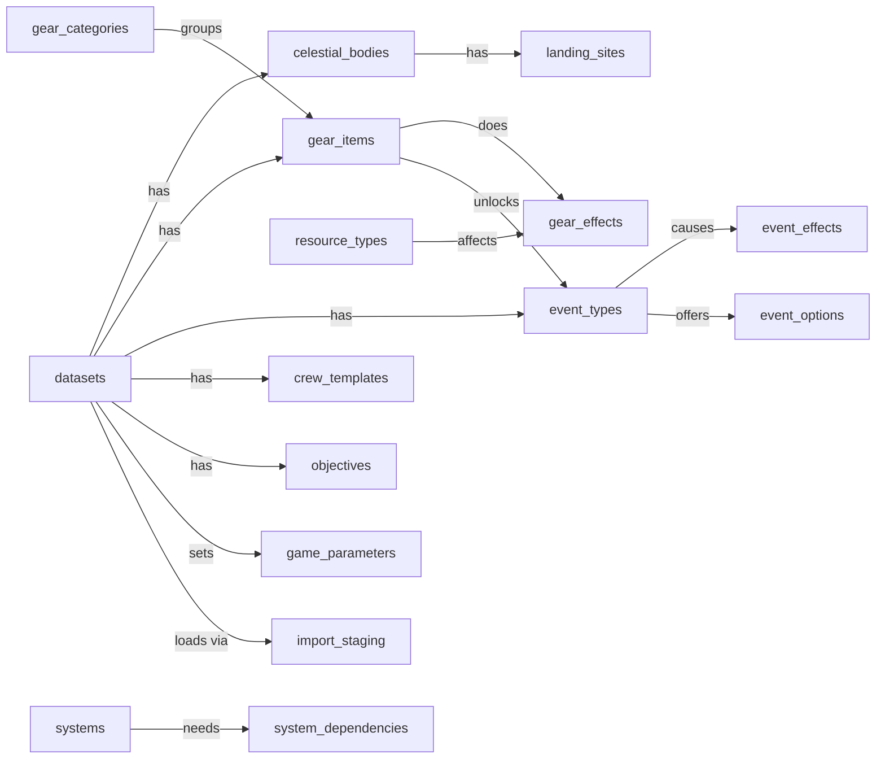
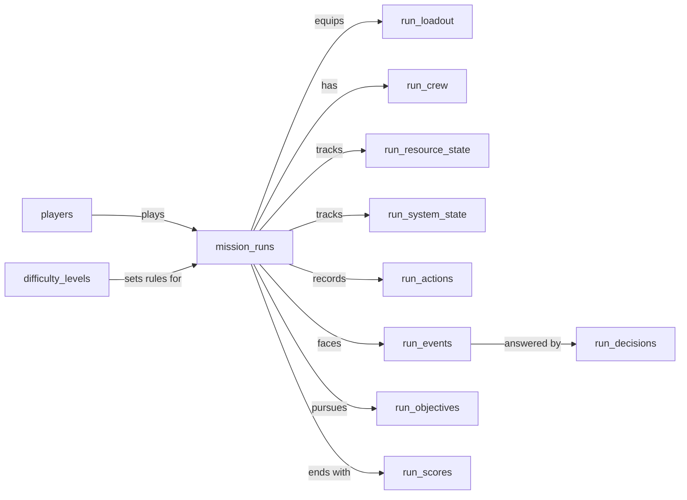

# ORBY 07: Backend Schema

*Logical data model and dataset plan · Document 7 of 7 · Version 1.1 · November 14, 2026 · Hackathon edition*

| | |
|---|---|
| This document owns | The logical data model, the dataset onboarding steps, the table-to-client mapping and the optional leaderboard server. |
| Read it if | The NASA dataset arrives and you must load, validate or map it. |
| It defers to | Rules (03), screens (04), stack (06). Companion file: orby_schema.sql. |

**How the seven documents stay aligned.** Each fact has one owner. If two documents seem to disagree, the document that owns the topic wins. The decision log, requirements, work packages and risks are in the *ORBY Technical Documentation and Project Plan v1.1*, which is the project plan and is not one of the seven.

## Shared facts (identical in all seven documents)

| Topic | Locked fact | Decision |
|---|---|---|
| Product | ORBY is an educational browser 3D survival game for ages 7 to 12. The mission name is ARTEMIS-III. | D-01 |
| Scenario | Four astronauts, 90 Earth days, lunar south pole. Season 01 is Moon only. Mars is shown locked as Season 02. | D-16 |
| Time | The simulation stores hours since landing. One tick is one game hour, 2,160 ticks per mission. The Moon clock reads DAY X / 90. SOL (24.66 h) is used only for Mars. | D-02 |
| Pacing | A full mission is played in 10 minutes at 1x, which is 3.6 game hours per second. The player gives standing orders. Pause is always available. Speeds are 1x, 1.25x, 1.5x, 1.75x and 2x. The game pauses at every event. | D-04 |
| Dark intervals | Mostly sunlit, with dark intervals by difficulty: Cadet 48 h, Pilot 72 h, Commander 100 h. 100 h = 4 days 4 hours = 4.17 Earth days = 4.06 sols. No 14-day night. | D-03 |
| Difficulty | Cadet (Easy), Pilot (Medium, default), Commander (Hard). | D-09 |
| Gear | Twelve modules (Power 3, Life support 4, Safety 3, Systems 2). Payload cap 1,800 kg. Default load 1,300 kg. All twelve weigh 2,470 kg. Nothing is mandatory. | D-06 |
| Radiation | A hydrogen-rich liner is built into the Regolith Storm Shelter Vault. There is no suit-based radiation weave. | D-07 |
| Reactor | The Kilopower Fission Reactor is labeled planned technology. All its numbers are game values. | D-08 |
| Meters | Four lifelines (Oxygen, Water, Food, Power / heat) feed four summary meters (Life Support, Power, Shielding, Crew Health). | D-05 |
| Power shortage | When power is short, the game switches off the least important loads first: science, then rovers, communications and heating. Life support is the last to go. The keep-alive priority, highest first, is life support, heating, communications, rovers, science. | DR-01 |
| Crew | Four astronauts. Names and roles come from the NASA dataset. Placeholders: Sarah Chen (Flight engineer), Marcus Vance (Medical officer), Elena Rostova (Geologist), Tyler Hayes (Pilot). Each role has a main task and a backup task (03, section 3.4). | D-13 |
| Endings | Mission Complete (tasks done, crew alive), Crew Survived (crew alive at the end) or Try again. Minimum survivors to win is a config value, set to 1. Stars are a game assumption. | D-14 |
| Guidance | A What to do now bar, coach marks, an Explain tooltip on every meter, event cards with cost and risk, and a Help key. | D-15 |
| Architecture | Client-only. No backend, no database, no /api route. Rules live in src/game and never import Three.js or React. Data lives in src/config and public/data. | D-10, D-11 |
| Routes | #/landing, #/menu, #/name, #/explore, #/briefing/1-4, #/gear, #/hangar, #/destination, #/launch, #/outpost, #/hab, #/result, #/leaderboard. | D-12 |
| Labels | Every number is labeled Sourced, Calculated, Unverified or Game assumption. A DATA SOURCE tag shows what comes from the NASA dataset. The baseline is inspired by NASA sources, not NASA data. | D-17 |

## The document set

| # | Document | Owns | Read it if |
|---|---|---|---|
| 01 | Research Paper | The science: findings, planning numbers with confidence labels, events and trade-offs, open verification items. | You need to know where a number or a claim comes from, or you are writing science text or an Explain tooltip. |
| 02 | Briefing | The story of the game for players and judges: what ORBY is, how to play, controls, and the demo script. | You are new to the project, you are writing player-facing text, or you are preparing the demo. |
| 03 | GameFlow | Every game rule and number: time and pacing, state, the hourly tick, dependencies, gear, events, difficulty, scoring and endings. | You are building or tuning the simulation, the balance script, the events or the gear data. |
| 04 | AppFlow | The 13 routes, what each screen shows and does, the copy on each screen, app state and the screen build order. | You are building a screen, the router or the state store. |
| 05 | UXUI Design | Look and feel: tokens, type, components, layouts, the two themes, mockups of the key screens, accessibility and plain-language rules. | You are styling, designing assets, or checking that a screen is readable for ages 7 to 12. |
| 06 | Technical Stack | The stack, the architecture rules, the folder structure, the visual upgrades, testing, the two-day plan and the AI prompts. | You are writing code, setting up the repo, or planning the hackathon hours. |
| 07 | Backend Schema | The logical data model, the dataset onboarding steps, the table-to-client mapping and the optional leaderboard server. | The NASA dataset arrives and you must load, validate or map it. |

## 1. Status in Season 01

**The game runs client-only** (decision D-10). There is no required backend, no Supabase project and no `/api` route. `orby_schema.sql` stays in the repository as the **logical data model**: it defines the entities, the label on every number and the rules for loading the NASA dataset. Each table maps to a client module (section 5), so the dataset can be swapped without a database.

Use the SQL file for three things only:

1. As the contract for the JSON files in `public/data` and the Zod schemas in the adapter.
2. To load and inspect a dataset in SQL first, if the team prefers.
3. As the base for an optional shared leaderboard (section 9), which is a stretch goal.

The file was loaded on PostgreSQL 16 and checked: 12 gear modules, 2,470 kg in total, 1,300 kg in the default load, 14 events with 39 options, and three difficulty levels with dark intervals of 48, 72 and 100 hours. The file is delivered with this document set as `orby_schema.sql`.

## 2. The idea in one paragraph

The real dataset arrives on hackathon day, so the model is built to accept it without code changes. Every content table (bodies, landing sites, gear, events, crew, objectives) stores a `dataset_id` and an `external_id`, so a dataset can be imported, versioned and switched on or off. Every content table has an `extra jsonb` column, so fields we did not plan for are kept instead of lost. Rules that depend on data (what a gear module produces, what an event does, which system needs which resource, every tunable number) are rows, not code. Every number carries a label (`sourced`, `calculated`, `unverified` or `game_assumption`), which is what the DATA SOURCE tag in the game shows.

The seed rows at the bottom of `orby_schema.sql` are the **game baseline**, inspired by NASA sources and not NASA data (D-17). Rows marked `game_assumption` or `draft` are tuned by the balance script and reviewed by the science leads before the dataset activates them.

## 3. Entity map

An arrow means "one to many": the table at the start of the arrow has many rows in the table at its end. The first map shows the dataset, the content and the rules. The second map shows what the game records during a run.

### 3.1 Dataset, content and rules



### 3.2 A run



## 4. Tables by group

| Group | Tables | Filled by |
|---|---|---|
| Dataset management | `datasets`, `import_staging` | Normalize script |
| Game vocabulary | `resource_types`, `systems`, `system_dependencies`, `difficulty_levels`, `gear_categories` | Seed file, tuned by the team |
| Parameters | `game_parameters` | Seed file, overridden by the dataset |
| Dataset content | `celestial_bodies`, `landing_sites`, `gear_items`, `gear_effects`, `event_types`, `event_effects`, `event_options`, `crew_templates`, `objectives` | Real dataset, plus DRAFT rows we author |
| UI copy | `content_blocks` | Team (briefing text, hints, Explain tooltips) |
| Player and runs | `players`, `mission_runs`, `run_loadout`, `run_crew`, `run_actions` | Game at runtime (client in Season 01) |
| History | `run_resource_state`, `run_system_state`, `run_events`, `run_decisions` | Game at runtime |
| Results | `run_objectives`, `run_scores`, view `leaderboard` | Game at runtime |
| Checks | view `run_loadout_mass` | Computed |

### How the screens use the tables

The routes are the ones in document 04, section 3.

- **#/explore and #/destination:** `celestial_bodies`. `time_unit`, `hours_per_unit` and `is_playable` decide the clock label and which bodies are locked (Mars is Season 02, D-16).
- **#/briefing/1 to 4:** `landing_sites`, `crew_templates`, `resource_types` (the four lifelines), `content_blocks`, and `difficulty_levels` for the Cadet (Easy), Pilot (Medium) and Commander (Hard) cards. Pilot is the default.
- **#/gear:** `gear_categories`, `gear_items`, `gear_effects` and `run_loadout`. The payload meter reads `run_loadout_mass`: 1,800 kg cap, 1,300 kg default load. `gear_items.covers_lifeline` drives the warning when power, water, oxygen or food has nothing packed. Nothing is mandatory, so gear never soft-locks the game (D-06).
- **#/hangar:** `crew_templates`. Four astronauts.
- **#/outpost and #/hab (visor HUD):** `run_resource_state`, `run_system_state`, `run_crew`, `run_events`, `event_options`. The four summary meters come from `resource_types.summary_meter` and the four lifelines from `resource_types.lifeline` (D-05).
- **#/result:** `mission_runs.ending` (Mission Complete, Crew Survived or Try again), `run_scores` (five-part score, stars) and `run_system_state.reason` for the plain-language Try again explanation.
- **#/leaderboard:** view `leaderboard`, or the local top 10 in Season 01.

## 5. Logical entity to client module

Build the client from this table.

| Logical entity | Client implementation |
|---|---|
| `datasets`, `import_staging` | Dataset manifest file and `scripts/normalize-dataset.ts` |
| `celestial_bodies`, `landing_sites` | `public/data/bodies.json`, `landingSites.json` |
| `gear_categories`, `gear_items`, `gear_effects` | `public/data/gear.json` with effects |
| `event_types`, `event_effects`, `event_options` | `public/data/events.json` |
| `resource_types`, `systems`, `system_dependencies` | `src/config/dependencies.ts` and resource config |
| `difficulty_levels` | `src/config/difficulty.ts` |
| `game_parameters` | `src/config/parameters.ts`, each value with its label |
| `crew_templates` | `public/data/crew.json` (names and roles from the NASA dataset, placeholders until then, D-13) |
| `objectives` | `public/data/objectives.json` |
| `content_blocks` | `src/config/missionBrief.ts` (briefing, hints, tooltips) |
| `players`, `mission_runs`, `run_*`, `run_scores` | `profileStore` (localStorage, key `orby.profile.v1`) and in-memory run state. The saved run is `orby.run.v1`. |
| view `leaderboard` | Local top 10 per mode, replaceable by a server |

## 6. Time model (D-02, D-03, D-04)

The simulation stores **one counter: hours since landing**. One tick is one game hour, 24 ticks per Earth day. The interface converts it for display, so the same engine can run a Moon mission and, in Season 02, a Mars mission.

| Quantity | Value |
|---|---|
| Moon clock | DAY = floor(hours / 24) + 1. SQL: `mission_day(hours)` |
| Mars clock | SOL = floor(hours / 24.66) + 1. SQL: `mission_sol(hours)` |
| Moon mission | 90 days = 2,160 hours (`mission_runs.total_hours`) |
| Mission clock | 10 minutes at 1x = 3.6 game hours per second. Pause and decisions stop the clock. |
| Dark interval | Cadet 48 h (2 days), Pilot 72 h (3 days), Commander 100 h (4 days 4 hours, 4.17 days, 4.06 sols). Stored in `difficulty_levels.dark_interval_hours`. |
| Speeds | 1x, 1.25x, 1.5x, 1.75x, 2x. Stored per run in `mission_runs.clock_speed`. The list is a config array. |

Run history is stored as **snapshots by hour** (`run_resource_state.hour`, `run_system_state.hour`), by default one snapshot every 24 hours. This keeps the result-screen charts small. Live state stays in memory. The saved run (`orby.run.v1`) is written once per game day (build default).

## 7. Loading the real dataset on hackathon day

1. **Register:** record name, version, source and license in the dataset manifest (a `datasets` row in SQL).
2. **Normalize:** run `scripts/normalize-dataset.ts`. It converts units (hours, kg, kW) and writes clean JSON to `public/data`. In SQL, raw rows go to `import_staging` as `payload jsonb` with an `entity` label and the dataset's own id as `external_id`. Staging never fails on odd formats.
3. **Validate:** the adapter checks every file with Zod, keeps unknown fields in `extra`, reports invalid rows (`status = 'error'` with a message) and falls back to the baseline for anything missing. **The adapter must never crash the game on bad input.**
4. **Author rules:** write gear effects and event data the dataset does not provide as `draft` rows. The science leads review every number before it becomes `active`.
5. **Activate and tag:** set the dataset active. Each parameter records whether it came from NASA data or the game baseline, and the interface shows the DATA SOURCE tag. Old runs keep the `dataset_id` they started with, so replays still work.

The step-by-step checks with `jq` are in document 06, section 9.

**Mapping template to fill in on the day:**

| Dataset field | Goes to | Notes |
|---|---|---|
| (their id) | `external_id` | Required, unique per entity |
| (their name) | `name` | |
| (their numbers) | typed columns such as `mass_kg`, `radius_km` | Convert units first. Times become hours. |
| (their confidence or source note) | `data_label` or `game_parameters.data_label` | sourced, calculated, unverified or game_assumption |
| (anything else) | `extra` | Keep it, even if unused |

**Examples of a record after mapping:**

```json
{ "entity": "celestial_body",
  "external_id": "moon", "slug": "moon", "name": "The Moon", "body_type": "moon",
  "time_unit": "day", "hours_per_unit": 24, "is_playable": true,
  "extra": { "note": "[from dataset]" } }
```

```json
{ "entity": "gear_item",
  "external_id": "GM-06", "category_code": "life_support",
  "name": "CO2 Removal and Reduction Unit", "mass_kg": 160, "default_packed": true,
  "data_label": "game_assumption",
  "effects": [ { "resource_code": "oxygen", "system_code": "co2_removal",
                 "effect_type": "recycle", "amount": 0.42, "unit": "ratio",
                 "per": "continuous", "status": "draft" } ] }
```

```json
{ "entity": "event_type",
  "external_id": "EV-03", "code": "recycler_fault", "priority": "M",
  "base_probability": 0.05, "min_hour": 72, "duration_hours": 12, "severity": 3,
  "options": [
    { "label": "Repair", "cost": { "crew_hours": 4, "spare_parts": 1 }, "risk": 0.15 },
    { "label": "Swap a spare cartridge", "cost": { "spare_parts": 2 }, "risk": 0.05 } ] }
```

Every option needs a cost and a risk (REQ-12). The SQL table rejects an option without them, and the Zod schema must do the same.

## 8. What one tick does

The rules live in `src/game` and import neither Three.js nor React. A full mission is 2,160 ticks, run with a fixed time step and an accumulator, so results do not depend on frame rate. The same order is described for players and designers in document 03, section 5.

1. Apply the player's standing orders and actions: tasks, EVAs, repairs, shelter orders.
2. Update lighting, dark intervals and dust accumulation.
3. Roll new events with the seeded generator (`rng_seed`, mulberry32). This step rolls **once per game day, at hour 0 of the day**. It uses `event_types.base_probability` (a per-day value) scaled by the difficulty's `event_frequency_mult`. It skips events whose `requires_gear_id` is not packed and events whose `min_hour` has not passed. EV-05 is scheduled at the start of a dark interval and does not use its probability. Pause the game when an event fires.
4. Apply active event effects.
5. Resolve dependencies in order: power, then water recovery, oxygen generation, CO₂ removal, communications. Where a requirement is below `min_level`, reduce that system's output by `penalty_pct` and write the reason to `run_system_state.reason`. When power is short, switch off the least important loads first by `systems.load_priority` (DR-01): science, rovers, communications and heating go before life support. Life support has the highest keep-alive priority and goes last.
6. Compute production and consumption for each resource.
7. Update crew health, morale, fatigue and radiation dose. Mark a crew member `lost` if health reaches zero.
8. Check end conditions: hour 2,160, the whole crew lost, or a lifeline at zero for longer than `grace_period_hours`.
9. Write the log. At the end, set `ending`, compute `run_scores` and `stars`, and set `ended_at`.

The same seed and the same choices always produce the same run.

## 9. Optional server (stretch goal)

If the team wants a shared leaderboard, add **three tables only**: `players`, runs and scores. The game submits a finished run with one call. For fairness, store the seed and the action log with the score, so a score can be recomputed on the server.

- `POST /scores` with callsign, difficulty, ending, stars, five-part score, seed and the action log.
- `GET /leaderboard?difficulty=pilot` returns the top 10.

Row-level security can restrict a player's rows to the owner. Any host works (a static site plus one serverless function, or a hosted PostgreSQL). **This is not required, and Season 01 does not depend on it.** The client never calls these routes in Season 01, so the rule "no `/api`" in documents 04 and 06 still holds.

The earlier full REST outline (create run, save loadout, advance day and so on) is retired. It assumed the server runs the simulation, which conflicts with D-10. If the team later moves the simulation to a server, rebuild that outline around the hourly tick in section 8.

## 10. Design notes

- **Fair competition.** `rng_seed` makes Compete runs reproducible. Two players on the same seed face the same events.
- **Result screen for free.** The hourly snapshots and the `reason` fields give the charts and the plain-language Try again explanation.
- **Win rules (D-14).** `ending` is `mission_complete` (tasks done, crew alive), `crew_survived` (crew alive at the end) or `try_again`. The minimum number of survivors to win is the `win_min_survivors` parameter, set to 1. Stars are a game assumption: 3 for tasks done with all four alive, 2 for all four alive, 1 for at least one alive.
- **Open questions at the dataset hand-off.** What entities does the dataset contain? Are the units consistent? Does it describe events and effects, or only bodies and facts? Does its license limit sharing it? (Actions A-08, A-12, A-14.)
- **Unverified numbers.** Life-support power (1 to 3 kW), CO₂ per person (about 1 kg) and a few others carry the label `unverified` until action A-05 checks them.

## 11. Check the SQL file

Run these on a scratch database. The expected results are the locked v1.1 numbers, so a changed number means the file has drifted from the other documents.

```bash
createdb orby_check
psql -v ON_ERROR_STOP=1 -d orby_check -f orby_schema.sql

# gear: expect 12 | 2470 | 1300
psql -d orby_check -At -c "select count(*), sum(mass_kg), sum(mass_kg) filter (where default_packed) from gear_items"

# difficulty: expect cadet 48 | pilot 72 | commander 100 (hours)
psql -d orby_check -At -c "select code, dark_interval_hours from difficulty_levels order by dark_interval_hours"

# events: expect 14, and 39 options, each with a cost and a risk
psql -d orby_check -At -c "select (select count(*) from event_types), (select count(*) from event_options)"

# keep-alive priority (DR-01): expect life support parts at 1, then heating, communications, rover
psql -d orby_check -At -c "select code, load_priority from systems where load_priority is not null order by load_priority, code"
```

## 12. Hackathon-day checklist (data work)

1. Read the dataset files. List the entities, the units and the license. Record them in the manifest.
2. Run the normalize script and fix any rows the adapter reports as invalid.
3. Fill the mapping table in section 7. The names and roles of the four astronauts replace the placeholders (D-13).
4. Add `draft` gear effects and event options for anything the dataset does not describe. Every option needs a cost and a risk.
5. Run the balance script (idle, sensible and reckless bots) on Cadet, Pilot and Commander. Check that a sensible player survives on Commander and an idle player does not. Tune the masses of the modules and the 1,800 kg cap only if the team agrees.
6. Ask the science leads to review every `draft` row, then set them `active`. Check that the DATA SOURCE tags show the right labels.
7. Play one full mission at 1x. It should take about 10 minutes and end in a win screen or a Try again screen that explains what happened.
8. Only if a shared leaderboard is wanted: create the three tables and the `POST /scores` call (section 9).
