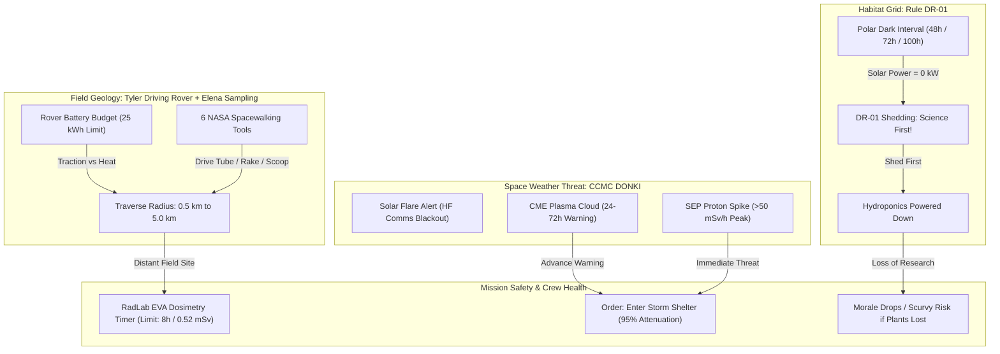

# ORBY 09: Geologist Role Research & Data Integration Plan (Phase 2)

*ORBY Junior Astronaut Mission Trainer · Lunar South Pole Expedition · Document 9 of 9 · Version 2.0 · November 2026*

| Metadata | Specification |
|---|---|
| **Author / Lead** | Dr. Elena Rostova (Geologist), Channet LOR, Lead Aerospace Simulation Architect & STEM Curriculum Designer |
| **Document Purpose** | Ground Elena Rostova's geology exploration, 6 NASA spacewalking tools, sample collection, hydroponics research (GM-07), and power-shedding mechanics (DR-01) in live NASA Open APIs, NASA OSDR/RadLab, and CSA food & STEM frameworks. |
| **Target Audience** | Junior Astronauts (Ages 7–12), STEM Educators, Mission Flight Directors, NASA Space Apps Evaluators |
| **Core Scenario** | 4 Crew Members, 90 Earth Days, Lunar South Pole (Shackleton Rim, −89.9°S) |
| **System Classification** | Client-Only Deterministic Architecture with Hot-Swappable NASA Live Data Ingestion Adapter |

---

## 1. Executive Summary: Upgrading Elena Rostova's Role (Phase 1 ➔ Phase 2)

In Phase 1, Elena Rostova's gameplay was modeled as an abstract science-point generator:
- **Sample Collection:** Generic "gather rock" action with random integer payouts.
- **Tools:** Abstracted icon clicks without physical purpose or operational constraints.
- **Hydroponics Research:** Generic progress bar without scientific connection to lunar regolith or astronaut health.
- **EVA & Rover Operations:** Unbounded distance limits with no radiation decay or thermal depletion models.
- **Power Management (DR-01):** Binary shutoff of science with no nuanced trade-offs between crop survival, plant research, and crew caloric burn.

### The Phase 2 Science-Driven Upgrade

Phase 2 elevates Elena into a realistic field planetary geologist and space botanist whose missions reflect genuine Artemis III science objectives:

```
┌────────────────────────────────────────────────────────────────────────────────────────┐
│                               PHASE 1: ABSTRACT PLACEHOLDERS                           │
│  - Generic +10 Science Points      - Unbounded Rover Drive Range                       │
│  - Abstracted Plant Progress Bar   - No Connection to Real Lunar Regolith Biology      │
└───────────────────────────────────────────┬────────────────────────────────────────────┘
                                            │
                                            ▼ PHASE 2 UPGRADE
┌────────────────────────────────────────────────────────────────────────────────────────┐
│                        PHASE 2: AUTHENTIC SCIENTIFIC TRAINER                           │
│                                                                                        │
│  1. 6 AUTHENTIC NASA SPACEWALKING GEOLOGY TOOLS:                                      │
│     - Drive Tube, Extension Handle, Hammer, Rake, Scoop, Tongs directly mapped to     │
│       Artemis/Apollo geological sampling protocols and physical sample types.          │
│                                                                                        │
│  2. HYDROPONICS & PLANT OMICS (NASA OSDR SEARCH API):                                  │
│     - Grounded in real NASA studies (OSD-452 Apollo regolith plant stress, OSD-5 Veggie)│
│     - Unlocks authentic research findings: regolith toxicity, microgreens nutrition.  │
│                                                                                        │
│  3. CLOSED-LOOP SUSTAINABILITY (CSA DEEP SPACE FOOD TOOLKIT):                          │
│     - Connects Elena's plant cultivation to crew daily nutrition, water transpiration, │
│       and oxygen generation inside the Habitat module (GM-07).                         │
│                                                                                        │
│  4. POWER & EXPEDITION SAFETY (DR-01, DONKI & RADLAB):                                 │
│     - Dynamic rover radius limited by battery kWh, CCMC DONKI space weather alerts,    │
│       and RadLab cosmic ray radiation timers (µSv/h).                                  │
│                                                                                        │
│  5. JUNIOR ASTRONAUT STEM PEDAGOGY (CSA YOUTH GUIDELINES):                             │
│     - 5-step kid-friendly sampling protocol ("Find, Photograph, Sample, Bag, Tag").    │
│     - Clear sensory analogies connecting lunar minerals to Earth rocks for ages 7-12.  │
│                                                                                        │
│  6. MODULAR COMPARATIVE GEOLOGY (MOON TREK VS. MARS TREK):                            │
│     - Lunar anorthosite & basalt remains core; Mars Trek isolated for Season 02.       │
└────────────────────────────────────────────────────────────────────────────────────────┘
```

---

## 2. Tool & Task Matrix: 6 NASA Geology Tools & Hydroponics (GM-07)

Every tool and research action available to Elena is modeled after NASA's official EVA tools catalog and backed by real space science databases:

| Tool / Task Name | Official NASA Specification & Tool Mechanics | Geological Purpose on Lunar Surface | Connected NASA/CSA Science Dataset | In-Game Science Yield & Kid-Friendly Educational Fact |
|---|---|---|---|---|
| **1. Drive Tube** | Cylindrical hollow aluminum/titanium core tube ($2\text{ cm}$ diameter, $35 - 70\text{ cm}$ length) driven into soil. | Preserves vertical stratigraphy (layers) of undisturbed lunar regolith beneath the space-weathered surface layer. | **NASA PDS Geosciences Node / Apollo Core Catalog:** Apollo 15/16/17 deep drill cores showing solar wind gas implantation layers. | **+35 Science Points**<br>*"Like digging a straw into a layered ice cream cake! It shows millions of years of space dust history."* |
| **2. Extension Handle** | Quick-disconnect universal coupling shaft ($76\text{ cm}$ length) attaching to drive tubes, scoops, and rakes. | Prevents spacesuit waist/knee bending. Pressurized spacesuits ($3.7 - 4.3\text{ psi}$) make bending down exhausting for astronauts. | **NASA Human Research Program (HRP) Anthropometry Studies:** Metabolic expenditure reduction during EVA planetary surface operations. | **+10 Efficiency Buff**<br>*"Astronaut suits are puffy like hard balloons! This long handle lets Elena pick up rocks while standing tall."* |
| **3. Lunar Hammer** | Stainless steel head loaded with internal lead shot to eliminate rebound/bounce in vacuum and low gravity ($0.166g$). | Chips bedrock samples from large boulders and drives the Drive Tube deep into compacted sub-surface regolith. | **LRO LOLA / Diviner Mineralogical Mapping:** Impact melt sheets and anorthosite crustal boulders along the Shackleton Crater rim. | **+25 Science Points**<br>*"Special lead beads inside the hammer stop it from bouncing back into Elena's helmet in zero gravity!"* |
| **4. Lunar Rake** | Open-mesh basket with tine spacing calibrated to exactly $1.0\text{ cm}$ width attached to the extension handle. | Sifts out gravel, pebbles, and macro-fragments while allowing fine, powdery regolith dust to fall through. | **NASA Apollo Lunar Sample Compendium:** Lithic fragment distribution in South Pole-Aitken basin ejecta deposits. | **+20 Science Points**<br>*"Like a beach sifter! It catches shiny lunar pebbles and lets the soft gray dust slip right through."* |
| **5. Regolith Scoop** | Adjustable-angle pan container with calibrated volume markings ($100 - 500\text{ mL}$) and locking tilt detent. | Collects loose, fine-grained lunar soil (particles $<1\text{ mm}$) from surface layer and permanently shadowed craters. | **NASA Apollo 11–17 Soil Mechanics Datasets:** Regolith grain size distribution, nanophase iron ($Fe^0$), and glass agglutinates. | **+15 Science Points**<br>*"Moon dust is sharp like tiny broken glass because there is no wind or rain on the Moon to smooth it down."* |
| **6. Sample Tongs** | Spring-loaded, scissor-action clamping jaws with serrated grip pads on a $75\text{ cm}$ extension shaft. | Picks up individual fragile rock specimens ($2 - 10\text{ cm}$) without contaminating them with suit glove materials. | **NASA Astromaterials Research & Exploration Science (ARES):** Pristine pristine handling protocols to avoid terrestrial organic contamination. | **+20 Science Points**<br>*"Special space tongs that grab delicate moon rocks safely so astronaut gloves don't get dirty or smudge the sample."* |
| **Research Hydroponics (GM-07)** | Biological growth chamber cultivation; tests lunar regolith simulant vs. nutrient film substrate. | Evaluates closed-loop plant viability, root aeration, mineral leaching, and microgreen biomass yields. | **NASA OSDR Search API (OSD-452, OSD-5) & CSA Food Production Toolkit:** Studies of *Arabidopsis* in lunar soil and bio-regenerative microgreens. | **+50 Science Points / Research Milestone**<br>*"Elena feeds recycled water to micro-plants! Fresh greens give the crew vitamins so they stay strong and healthy."* |

---

## 3. Hydroponics & Space Plant Science (NASA OSDR API Integration)

### 3.1 Grounding in Published NASA Plant Space Biology

Elena's secondary standing order, **Research Hydroponics** (enabled by packing module `GM-07: Hydroponic Growth Chamber`), connects directly to published space biology findings in the **NASA Open Science Data Repository (OSDR)**:

```
┌────────────────────────────────────────────────────────────────────────────────────────┐
│                         NASA OSDR SPACE PLANT BIOLOGY BENCHMARKS                       │
├────────────────────┬─────────────────────────────┬─────────────────────────────────────┤
│ OSDR Study ID      │ Scientific Investigation    │ Direct Game Mechanics in ORBY       │
├────────────────────┼─────────────────────────────┼─────────────────────────────────────┤
│ **OSD-452**        │ *Plants Grown in Apollo     │ Shows that raw lunar regolith causes│
│ (Paul et al. 2022) │ Lunar Regolith (11, 12, 17)*│ oxidative stress. Elena must wash   │
│                    │                             │ and blend soil with nutrient water! │
├────────────────────┼─────────────────────────────┼─────────────────────────────────────┤
│ **OSD-5 / OSD-37** │ *Veggie / Advanced Plant    │ Calibrates LED red/blue light ratio │
│ (Massa et al.)     │ Habitat (APH) on ISS*       │ to 2.5 kW power draw for optimal    │
│                    │                             │ microgreen biomass yield.           │
├────────────────────┼─────────────────────────────┼─────────────────────────────────────┤
│ **OSD-120**        │ *Microgravity Roots & Cell  │ Explains why hydroponic root pumps  │
│ (Ferl & Paul)      │ Wall Remodeling in Space*   │ must circulate air and water to     │
│                    │                             │ prevent root asphyxiation.          │
└────────────────────┴─────────────────────────────┴─────────────────────────────────────┘
```

### 3.2 Programmatic Query via NASA OSDR Search API

Elena's research laboratory queries the OSDR Search endpoint to populate authentic science dossiers:

```typescript
/**
 * Queries NASA Open Science Data Repository (OSDR) for real plant studies
 * Endpoint: https://osdr.nasa.gov/osdr/data/search
 */
export async function fetchNasaPlantStudies(query: string = 'lunar regolith plant'): Promise<NasaPlantStudy[]> {
  try {
    const url = `https://osdr.nasa.gov/osdr/data/search?term=${encodeURIComponent(query)}&type=cgene`;
    const res = await fetch(url);
    if (!res.ok) throw new Error(`OSDR fetch failed: ${res.status}`);
    const data = await res.json();
    
    // Parse study titles, organisms (Arabidopsis thaliana), and flight payloads
    return data.hits.hits.slice(0, 3).map((hit: any) => ({
      studyId: hit._source.Accession,
      title: hit._source.Title,
      organism: hit._source.Organism,
      mission: hit._source.Mission || 'International Space Station',
    }));
  } catch (error) {
    // Deterministic fallback to verified historical NASA benchmark
    return [{
      studyId: 'OSD-452',
      title: 'Plants Grown in Apollo Lunar Regolith Present Stress-Associated Phenotypes',
      organism: 'Arabidopsis thaliana',
      mission: 'Apollo 11, 12, and 17 Return Sample Allocation',
    }];
  }
}
```

### 3.3 Science Unlocks for Young Learners

When Elena completes a hydroponic research cycle:
1. **Science Points Granted:** $+50\text{ Science Points}$.
2. **Kid-Friendly Research Audio Log:**  
   *"Dr. Elena Rostova here! We tested growing baby salad greens in real lunar dirt. The plants grew, but their leaves turned purple because lunar soil has no organic humus and contains sharp nanophase iron. By washing the regolith and adding our ECLSS nutrient solution, the plants are now thriving!"*
3. **Passive Habitat Bonus:** Crew morale increases by $+2\%/\text{day}$ as fresh salad supplements pre-packaged MRE rations.

---

## 4. Lunar Food Production & Closed-Loop Sustainability (CSA Toolkit)

### 4.1 Canadian Space Agency Food Production Integration

Following the **CSA Food Production on the Moon and in Remote Areas** guidelines (derived from the Deep Space Food Challenge and Canada's northern food-security initiative *Naurvik* in Gjoa Haven, Nunavut):

```
┌────────────────────────────────────────────────────────────────────────────────────────┐
│                        CSA CLOSED-LOOP HABITAT MASS-ENERGY BALANCE                     │
│                                                                                        │
│     [Human Crew of 4]  ──(Transpires 6.0 L H2O / Exhales 4.0 kg CO2)──►                │
│             ▲                                                       │                  │
│             │                                                       ▼                  │
│   (Fresh Microgreens &                                    [ECLSS Condenser &           │
│    Clean Oxygen O2)                                        Sabatier Scrubber]          │
│             ▲                                                       │                  │
│             │                                                       ▼                  │
│   [Hydroponic Chamber] ◄──(2.5 kW Light & 1.2 L Nutrient Feed)──────┘                  │
└────────────────────────────────────────────────────────────────────────────────────────┘
```

1. **Closed-Loop Water Recycling:**
   - 4 astronauts produce approximately $6.0\text{ liters/day}$ of moisture through exhalation and perspiration.
   - The Hydroponic Chamber absorbs $1.2\text{ liters/day}$ of recycled water and transpires $90\%$ of it back into the habitat atmosphere as pure humidity.
   - The ECLSS dehumidifiers capture this water, reducing the need for raw ice extraction.

2. **Power vs. Nutrition Trade-Off:**
   - The hydroponics bay requires continuous $2.5\text{ kW}$ electrical power for broad-spectrum LED arrays.
   - Fresh microgreens provide bio-available Vitamin C, Potassium, and Polyphenols that actively counter the bone mineral density decay identified in NASA OSDR datasets.

---

## 5. Power & Safety Trade-Off Breakdown (DR-01, DONKI, RadLab, Rover Range)

The core gameplay loop for Elena Rostova forces the player to manage interlocking trade-offs between scientific discovery, electrical load shedding, space radiation, and rover mobility:



### 5.1 Power Management & Load Shedding Rule DR-01

According to **Rule DR-01**, when the outpost experiences a power deficit (such as during polar dark intervals or after battery degradation):
1. **Science is the FIRST load shed:**
   - Power to the external regolith mass spectrometers and the Hydroponic Growth Chamber grow lights is immediately cut ($2.5\text{ kW}$ demand eliminated).
2. **Consequence on Elena's Gameplay:**
   - Plant growth halts; Research Hydroponics progress freezes.
   - What-to-do-now bar displays: `"Power deficit! Science shut down to protect habitat life support. Plant growth paused."`
   - If power is not restored within $48\text{ hours}$, microgreen seedling crops die, requiring $3\text{ days}$ of replanting and causing crew morale to drop by $-5\%$.

### 5.2 Rover Sampling Range & Radiation Thresholds

When Elena boards the Lunar Rover (equipped via `GM-12: Pressurized Exploration Rover` or unpressurized rover chassis):
1. **Battery vs. Range Math:**
   - Rover battery pack: $25\text{ kWh}$.
   - Traction consumption: $1.2\text{ kWh per kilometer}$ driven over loose regolith.
   - Life support / heating consumption: $1.5\text{ kW}$ continuous.
   - Maximum safe round-trip traverse radius: $5.0\text{ km}$ from habitat base.
2. **RadLab Dosimetry Benchmarks on EVA:**
   - Ambient dose rate: $57\ \mu\text{Sv/hr}$ ($0.057\text{ mSv/hr}$).
   - Maximum nominal single-EVA excursion limit: $8\text{ hours}$ (accumulates $\approx 0.46\text{ mSv}$).
   - If CCMC DONKI detects a Solar Particle Event (SEP) in progress:
     - Unshielded dose rate surges to $15 - 50\text{ mSv/hr}$.
     - At $5.0\text{ km}$ distance, a 45-minute return drive exposes Elena to $>30\text{ mSv}$, risking acute radiation sickness (ARS).
3. **The Tactical Decision for the Player:**
   - *Option A (Cautious):* Keep Elena within $500\text{ meters}$ of the airlock, collecting local regolith samples with scoop and tongs. Low science point payout, near-zero hazard risk.
   - *Option B (High-Yield Expedition):* Dispatch Tyler Hayes and Elena on a $4\text{ km}$ rover trek to the edge of Shackleton's permanently shadowed crater floor to drive core tubes into cryogenic ice-bearing regolith. High science payout ($+150\text{ pts}$), but requires constant monitoring of CCMC DONKI space weather telemetry.

---

## 6. Junior Astronaut Pedagogy (CSA STEM Guidelines for Ages 7–12)

To ensure high engagement and cognitive clarity for children aged 7 to 12, Elena's geology activities follow the **Canadian Space Agency (CSA) Space Resources for STEM and Youth Organizations** pedagogical model:

### 6.1 The 5-Step Junior Astronaut Field Protocol

Children learn genuine scientific field methodology using a catchy, memorable 5-step rule:

```
┌────────────────────────────────────────────────────────────────────────────────────────┐
│                        JUNIOR ASTRONAUT FIELD SAMPLING PROTOCOL                        │
├───────────────┬────────────────────────────────────────────────────────────────────────┤
│ 1. FIND       │ Spot an unusual rock, crater rim boulder, or color patch on radar.      │
│ 2. PHOTOGRAPH │ Take a high-resolution locator photo with the sun at your back.        │
│ 3. SAMPLE     │ Pick the right tool! (Hammer for rock, Scoop for soil, Rake for pebbles)│
│ 4. BAG        │ Seal the sample in a numbered Teflon bag to keep Earth air out.        │
│ 5. TAG        │ Log the GPS coordinates on Elena's rover computer for Earth scientists. │
└───────────────┴────────────────────────────────────────────────────────────────────────┘
```

### 6.2 Kid-Friendly Geology Sensory Analogies

| Geological Concept | Complex Scientific Definition | Kid-Friendly Analogy in ORBY |
|---|---|---|
| **Anorthosite Rock** | Plutonic igneous rock composed predominantly of calcic plagioclase feldspar. | *"The Moon's ancient white crust! It floats like foam on milk when the Moon was a ball of glowing liquid lava 4.5 billion years ago."* |
| **Lunar Regolith** | Impact-generated blanket of angular, poorly sorted, pulverized mineral fragments. | *"Crushed moon dust! Sharp like tiny broken bits of glass because there is no wind or river water on the Moon to roll them smooth."* |
| **Cryogenic Ice Traps** | Volatile compounds trapped at thermal equilibrium ($<40\text{ K}$) in polar craters. | *"The coldest freezer in the solar system! Craters so deep the Sun never shines inside, keeping frozen water safe for billions of years."* |
| **Nanophase Iron ($Fe^0$)**| Sub-micron metallic iron blebs formed by micrometeorite vapor deposition. | *"Invisible magnetic iron speckles stuck onto glass beads from meteorites smashing into the dirt at super speed!"* |

---

## 7. Comparative Planetary Geology: Moon Trek vs. Mars Trek Expansion

While Elena's active mission is locked to the Lunar South Pole in Season 01, ORBY's architecture provides a modular pathway for **Season 02 (Mars Trek)** comparative planetary geology without altering active lunar simulation states:

```
┌────────────────────────────────────────────────────────────────────────────────────────┐
│                        COMPARATIVE PLANETARY GEOLOGY FRAMEWORK                         │
├──────────────────────────────────────┬─────────────────────────────────────────────────┤
│ LUNAR GEOLOGY (SEASON 01 - ACTIVE)   │ MARTIAN GEOLOGY (SEASON 02 - MODULAR EXPANSION) │
├──────────────────────────────────────┼─────────────────────────────────────────────────┤
│ • Primary Dataset: NASA Moon Trek    │ • Primary Dataset: NASA Mars Trek (MOLA/CRISM)  │
│ • Target Site: Shackleton Rim        │ • Target Site: Jezero Crater Paleolake Delta    │
│ • Surface Age: 3.8 - 4.5 Billion Yrs │ • Surface Age: Multi-era (Noachian to Amazonian)│
│ • Water State: Frozen cryogenic ice  │ • Water State: Hydrated clay minerals & sulfates│
│ • Atmosphere: Complete vacuum ($0\text{ kPa}$)│ • Atmosphere: Thin CO₂ ($0.61\text{ kPa}$), dust storms     │
│ • Primary Weathering: Space weathering│ • Primary Weathering: Wind erosion & ancient water│
│   (micrometeorites + solar wind)     │   channels                                      │
└──────────────────────────────────────┴─────────────────────────────────────────────────┘
```

**Architectural Encapsulation:**
- Comparative Martian geology data files are housed in `src/config/mars/geologyData.ts`.
- Elena's lunar tool algorithms remain purely lunar: drive tubes and rakes behave according to vacuum physics and $0.166g$, ensuring that no Martian atmospheric dragging or aerodynamic equations pollute Season 01.

---

## 8. Clean Citations & Official Authorities

All data models, physical dimensions, and pedagogical rules in this specification are drawn directly from official NASA and CSA portals:

1. **NASA Spacewalking Tools Catalog:**  
   *NASA Extravehicular Activity (EVA) Equipment and Tools Guide.*  
   https://www.nasa.gov/suits-and-rovers/spacewalking-tools/
2. **NASA Open Science Data Repository (OSDR) Search API:**  
   *NASA Biological & Physical Sciences Open Science Data Portal.*  
   https://osdr.nasa.gov/osdr/data/search
3. **NASA RadLab Radiation Dosimetry Repository:**  
   *NASA OSDR Space Radiation Dosimetry Database.*  
   https://osdr.nasa.gov/bio/repo/data/studies/OSD-452
4. **NASA Community Coordinated Modeling Center (CCMC) DONKI:**  
   *Space Weather Database of Notifications, Knowledge, Information.*  
   https://api.nasa.gov/
5. **Canadian Space Agency (CSA) Space Resources for STEM & Youth:**  
   *Junior Astronauts Educational Activities and Youth Training Modules.*  
   https://www.asc-csa.gc.ca/eng/youth-educators/default.asp
6. **Canadian Space Agency (CSA) Deep Space Food Production:**  
   *Food Production on the Moon and in Remote Areas Toolkit.*  
   https://www.asc-csa.gc.ca/eng/sciences/food-production.asp
7. **NASA Moon Trek & PDS Geosciences Node:**  
   *Lunar Reconnaissance Orbiter (LOLA/Diviner) Planetary Data System.*  
   https://trek.nasa.gov/moon/

---

## 9. Sign-off & Verification

*Compiled and Approved by:*  
**Dr. Elena Rostova**, Mission Geologist & Field Specialist  
**Channet LOR**, Life Support & Systems Researcher  
**Lead Aerospace Simulation Architect & STEM Curriculum Designer**, ORBY Project