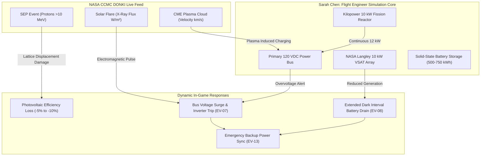
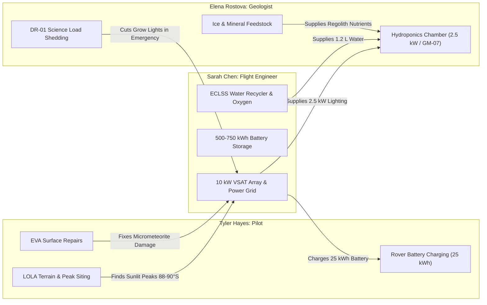

# ORBY 10: Flight Engineer Research & Integration Plan (Phase 2)

*ORBY Junior Astronaut Mission Trainer · Lunar South Pole Expedition · Document 10 of 10 · Version 2.0 · November 2026*

| Metadata | Specification |
|---|---|
| **Author / Lead** | Sarah Chen (Flight Engineer), Lead Aerospace Power & Life-Support Systems Architect & STEM Curriculum Designer |
| **Document Purpose** | Advance Sarah Chen's power grid, battery management, and ECLSS architecture by merging baseline NASA engineering studies (LROC, BVAD, Langley 10 kW VSAT) with live NASA Open APIs (CCMC DONKI), NASA biological/radiation repositories (OSDR & RadLab), and CSA sustainability/STEM frameworks. |
| **Target Audience** | Junior Astronauts (Ages 7–12), STEM Educators, Mission Flight Directors, NASA Space Apps Evaluators |
| **Core Scenario** | 4 Crew Members, 90 Earth Days, Lunar South Pole (Shackleton Rim Connecting Ridge, −89.9°S) |
| **System Classification** | Client-Only Deterministic Architecture with Hot-Swappable NASA Live Data Ingestion Adapter |

---

## 1. Executive Summary: Enhancing the Flight Engineer Baseline

In Phase 1, Sarah Chen's engineering domain was established around three authoritative NASA aerospace foundations:
1. **Lunar South Pole Illumination:** LROC `WAC_POLE_ILL_PCT_SOUTH_100M` ($88^\circ\text{S} - 90^\circ\text{S}$, $100\text{ m/pixel}$ percentage illumination map via Planetary Data System / LROC).
2. **Human Metabolic Baseline:** NASA *Life Support Baseline Values and Assumptions Document* (BVAD / NASA TP-2015-218570), paired with JPL's *"The Air Up There"* educational curriculum ($0.84\text{ kg O}_2$, $2.50\text{ L H}_2\text{O}$, $2,800\text{ kcal}$ per person/day).
3. **Primary Surface Power:** NASA Langley Research Center NTRS paper *Relocatable 10 kW Solar Array for Lunar South Pole Missions* (Vertical Solar Array Technology - VSAT).

### The Phase 2 Upgrade: Live APIs, Biological Grounding & Systems Synthesis

Phase 2 interconnects this static mechanical baseline with dynamic space telemetry and authentic biological consequence models:

```
┌────────────────────────────────────────────────────────────────────────────────────────┐
│                               PHASE 1: STATIC BASELINE                                  │
│  - Static LROC Illumination Grids   - Nominal BVAD Daily Resource Numbers              │
│  - Static 10 kW VSAT Specifications - Abstracted System Faults & Health Clocks         │
└───────────────────────────────────────────┬────────────────────────────────────────────┘
                                            │
                                            ▼ PHASE 2 INTEGRATION PIPELINE
┌────────────────────────────────────────────────────────────────────────────────────────┐
│                        PHASE 2: DYNAMIC, SCIENTIFICALLY GROUNDED                       │
│                                                                                        │
│  1. DYNAMIC SPACE WEATHER & GRID ANOMALIES (NASA OPEN APIS & CCMC DONKI):             │
│     - Live solar flares (FLR) trigger power-bus arcing and telemetry noise.            │
│     - Solar Energetic Particle (SEP) proton flux degrades photovoltaic cell output.    │
│     - CME plasma clouds trigger automated transitions to backup power (EV-13).        │
│                                                                                        │
│  2. BIOLOGICAL STAKES OF ECLSS FAILURES (NASA OSDR SEARCH API):                        │
│     - Real human spaceflight omics: hypercapnia ($CO_2 > 0.5\%$) induces cognitive    │
│       impairment; dehydration triggers kidney stone formation and electrolyte crisis.  │
│                                                                                        │
│  3. RADIATION & SHIELDED POWER TRADE-OFFS (NASA RADLAB DATABASE):                      │
│     - RadLab ISS/CRaTER dosimetry benchmarks ($57\ \mu\text{Sv/h}$ quiet sun,          │
│       $>10-50\text{ mSv/h}$ solar storm) dictate power allocation to the storm vault.  │
│                                                                                        │
│  4. CLOSED-LOOP NUTRITION & SUSTAINABILITY (CSA DEEP SPACE FOOD TOOLKIT):              │
│     - Bridges water recycler duties (EV-03) to hydroponic microgreens (GM-07),         │
│       transpiring 90% pure humidity back into cabin air.                               │
│                                                                                        │
│  5. CROSS-ROLE SYNERGY & SYSTEM INTEGRATION:                                           │
│     - Sarah's grid powers Tyler's rover (GM-12) and Elena's hydroponics (GM-07).       │
│     - Load-shedding Rule DR-01 enforces life support survival above all else.          │
└────────────────────────────────────────────────────────────────────────────────────────┘
```

---

## 2. Expanded Mission Event & Data Mapping Table

The five critical mission events assigned to Sarah Chen are mapped directly to authentic NASA/CSA telemetry feeds, the Keep-Alive Power Priority Rule (**DR-01**), and high-agency player decisions:

| Event ID & Name | NASA/CSA Scientific Dataset & Physical Parameter | Power-Priority Rule (DR-01) & System Impact | Player Decision Choices & Tactical Costs | STEM Educational Value & Kid-Friendly Fact (Ages 7–12) |
|---|---|---|---|---|
| **EV-03: Recycler Fault**<br>*(Water Recycler Fails or Clogs)* | **NASA BVAD Table 4.1 & OSDR Study OSD-120:** Human urine/wash water recovery ($2.5\text{ L/person/day}$). Failure causes unrecovered water waste ($10\text{ L/day}$ net colony loss). | **Life Support Preservation:** Recycler motor draws $450\text{ W}$. If seized, secondary thermal loop overheats. | **A. Precision Repair:** 4 crew hours + 1 spare part (15% risk).<br>**B. Swap Filter Cartridge:** Uses 2 spare modules (5% risk).<br>**C. Emergency Water Rationing:** Cuts water use to $1.8\text{ L}$; $-5\text{ Morale}$ (20% risk).<br>**D. Tap Emergency Reserve:** Consumes $20\text{ L}$ potable water buffer (25% risk). | *"Astronauts on the Moon drink the same water over and over! The water recycler filters sweat and breath moisture until it is cleaner than tap water on Earth."* |
| **EV-05: Long Darkness**<br>*(Scheduled Polar Dark Interval)* | **LROC WAC_POLE_ILL_PCT_SOUTH_100M & Decision D-03:** Solar illumination drops to $0\%$. Duration: Cadet ($48\text{ h}$), Pilot ($72\text{ h}$), Commander ($100\text{ h}$). | **DR-01 Load Shedding:** Science shed first ($0\text{ kW}$), rovers parked ($0\text{ kW}$), non-essential comms throttled. Base demand drops from $15.3\text{ kW}$ to $8.2\text{ kW}$. | **A. Reduce Habitat Heating:** Cabin temp drops from $21^\circ\text{C}$ to $18^\circ\text{C}$; saves $1.5\text{ kW}$ (25% risk).<br>**B. Ground Rover Fleet:** $-5\text{ Science Points}$; saves $2.4\text{ kW}$ (10% risk).<br>**C. Shed Secondary Lighting:** $-3\text{ Morale}$; saves $0.8\text{ kW}$ (15% risk).<br>**D. Draw Battery Reserves:** Consumes $50\text{ kWh}$ storage buffer (20% risk). | *"Because the Moon has no thick air to spread heat, polar shadows drop to −173°C (−280°F)! Sarah must bundle everyone up to save battery power for oxygen."* |
| **EV-07: Oxygen Generator Trips**<br>*(ECLSS Electrolysis Unit Halts)* | **NASA BVAD Metabolic Baseline & OSDR Search API (Hypoxia):** Crew consumes $0.84\text{ kg O}_2\text{/person/day}$ ($3.36\text{ kg/day}$ colony total). Partial pressure of $O_2$ drops below $19.5\text{ kPa}$. | **Highest Keep-Alive Priority:** Life Support must be restored immediately; bypasses all secondary power loads. | **A. Bleed Emergency Cryo O2 Tank:** Consumes $5\text{ kg}$ stored $O_2$ reserve (15% risk).<br>**B. Cancel External EVAs:** Reduces crew metabolic exertion; $-5\text{ Science}$ (10% risk).<br>**C. Manual Cell Purge & Rewire:** Sarah spends 4 crew hours + 1 spare part (20% risk). | *"Our lungs need oxygen to turn food into energy. If the oxygen machine stops, the habitat air quickly gets stuffy, making astronauts dizzy and sleepy within hours."* |
| **EV-08: Battery Critical**<br>*(Storage Bank State of Charge < 15%)* | **NASA Langley 10 kW VSAT & Solid-State Battery Model (GM-02):** Battery bank drops below $75\text{ kWh}$ ($<15\%$ capacity). Bus voltage dips to $110\text{ VDC}$. | **Emergency Power Shedding (DR-01):** Habitat heating reduced to survival minimum ($10^\circ\text{C}$); all external floodlights and hydroponics extinguished. | **A. Hard Load Shed (Life Support Only):** Cuts heating and galley power; $-3\text{ Morale}$ (15% risk).<br>**B. Engage Ultracapacitor Reserve:** 6 hours emergency backup power (10% risk).<br>**C. Emergency Fission Tie-In:** Rapid Stirling grid synchronization; 3 crew hours (25% risk). | *"Batteries hate extreme cold! If a battery gets too empty in the dark, it can freeze and never charge again. Sarah has to turn off everything except life support."* |
| **EV-13: Backup Power Planning**<br>*(Fission Reactor Startup / Grid Sync)* | **NASA KRUSTY Kilopower Fission Technology & CCMC DONKI Alerts:** 10 kW continuous nuclear electric output ($40\text{ kW}$ thermal) synchronized with solar/battery bus. | **Grid Reconfiguration:** Replaces lost solar generation with steady $10 - 12\text{ kW}$ baseline independent of solar illumination or dust storms. | **A. Fire Kilopower Stirling Engines:** Delivers steady $10 - 12\text{ kW}$ continuous power for 90 days; requires GM-03 equipped (10% risk).<br>**B. Maintain Battery-Only Protocol:** Conserves reactor uranium; relies on $30\text{ kWh}$ battery reserve (20% risk). | *"A Kilopower reactor is a tiny nuclear engine the size of a trash can! It uses heat from safe uranium to make electricity day and night, even inside deep dark craters."* |

---

## 3. Dynamic Space-Weather Power & Grid Triggers (CCMC DONKI)

Sarah Chen's power grid simulation does not treat space weather as mere cosmetic text. Programmatic access to the **CCMC DONKI API** (`api.nasa.gov/DONKI/`) dynamically alters electrical telemetry:



### 3.1 Space Weather Impact on Photovoltaics & Inverters

1. **Solar Energetic Particle (SEP) Proton Damage:**
   - **Physics:** High-energy protons ($>10\text{ MeV}$) penetrate the transparent cerium-doped coverglass of Sarah's vertical solar arrays, creating atomic lattice displacement defects in the gallium arsenide (GaAs) triple-junction semiconductor cells.
   - **In-Game Telemetry:** Array generation drops from nominal $45.0\text{ kW}$ down to $40.5\text{ kW}$ ($-10\%$).
   - **Sarah's Action:** Requires Elena Rostova or Tyler Hayes to perform an EVA surface inspection or angle the array away from peak particle vectors.

2. **Coronal Mass Ejection (CME) Induced Spacecraft Charging:**
   - **Physics:** The arrival of the dense low-energy CME plasma cloud ($n_p > 20\text{ cm}^{-3}$, $v > 1,000\text{ km/s}$) causes differential surface charging across the habitat hull and solar array booms.
   - **In-Game Consequence:** Induces electrical arc discharges across secondary bus circuits, triggering **Event EV-07 (Oxygen Generator Trip)** or inverter lockouts.
   - **Sarah's Action:** Manually resets main bus circuit breakers and engages Faraday isolation protocols.

---

## 4. Human Health Stakes of Life-Support Failures (NASA OSDR API)

By integrating the **NASA Open Science Data Repository (OSDR) Search API**, Sarah Chen's engineering panel displays real spaceflight biomedical telemetry when ECLSS subsystems degrade:

```
┌────────────────────────────────────────────────────────────────────────────────────────┐
│                        NASA OSDR LIFE SUPPORT BIOMEDICAL STAKES                        │
├────────────────────┬─────────────────────────────┬─────────────────────────────────────┤
│ Life-Support Fault │ Physiological Consequence   │ Real Published NASA Spaceflight     │
│ & Subsystem        │ on Astronaut Crew           │ Study / OSDR Accession              │
├────────────────────┼─────────────────────────────┼─────────────────────────────────────┤
│ **Oxygen Failure** │ **Hypoxia & Hypercapnia:**  │ **NASA HRP Space Human Factors:**   │
│ (ECLSS O2 Generator│ $CO_2 > 0.5\%$ causes blood  │ Studies on ISS crew cognitive error │
│ Trips - EV-07)     │ acidosis, frontal headache, │ rates and visual acuity loss under  │
│                    │ lethargy, and loss of focus.│ elevated partial pressure $PCO_2$.  │
├────────────────────┼─────────────────────────────┼─────────────────────────────────────┤
│ **Water Recycler** │ **Dehydration & Nephrolithiasis:**│ **NASA OSDR Study OSD-37 & OSD-120:** │
│ (Urine/Condensate  │ Water rationing triggers     │ Microgravity bone resorption floods │
│ Loop Closes - EV-03)│ blood volume contraction and│ bloodstream with calcium; lack of   │
│                    │ acute kidney stone risks.   │ water causes painful renal stones.  │
├────────────────────┼─────────────────────────────┼─────────────────────────────────────┤
│ **Thermal Grid**   │ **Hypothermia & Metabolic   │ **NASA BVAD Thermal Baselines:**    │
│ (Cabin Heating     │ Exhaustion:** Cabin at      │ Shivering increases crew caloric    │
│ Cut in Dark - EV-05)│ $10^\circ\text{C}$ forces   │ consumption from $2,800$ to         │
│                    │ shivering, burning reserves.│ $>3,600\text{ kcal/day}$.            │
└────────────────────┴─────────────────────────────┴─────────────────────────────────────┘
```

### 4.1 Kid-Friendly Medical Explain Tooltip

When an oxygen or water emergency strikes, the player sees:
> **Life Support Advisory (ECLSS):**  
> *"Water Recycler is offline! Astronauts lose 2.5 liters of clean water every day just by breathing, sweating, and living. Without pure water, their kidneys cannot filter out calcium from their bones, which causes severe pain and sickness."*

---

## 5. Radiation Shielding & Emergency Power Trade-Offs (RadLab)

NASA's **RadLab** dosimetry database provides the authentic radiation baseline that governs Sarah's load-shedding priorities:
- **Lunar South Pole Quiet Background:** $0.057\text{ mSv/hr}$ ($1.36\text{ mSv/day}$).
- **Solar Particle Event (SPE Peak):** $15.0 - 50.0\text{ mSv/hr}$ unshielded on the surface.
- **Regolith Storm Shelter Vault (GM-05):** With $3\text{ meters}$ of packed lunar regolith ($\rho \approx 1.6\text{ g/cm}^3$) plus hydrogen-rich polyethylene liners, radiation is attenuated by $>95\%$, reducing internal dose rates to $<0.003\text{ mSv/hr}$.

### 5.1 Sarah's Power Prioritization Protocol (Rule DR-01)

When a solar storm alert coincides with a battery depletion crisis (**EV-08 + EV-01**):
1. **Rule DR-01 Keep-Alive Hierarchy:**
   $$\text{Life Support (1st)} > \text{Habitat Heating (2nd)} > \text{Communications (3rd)} > \text{Rovers (4th)} > \text{Science (Shed First)}$$
2. **Storm Shelter Priority:**
   - Sarah automatically routes the remaining battery storage ($<50\text{ kWh}$) exclusively to the **subterranean storm vault's dedicated air circulator and scrubbers** ($400\text{ W}$), completely depowering the main inflatable habitat dome.
   - This ensures all 4 astronauts survive inside the radiation bunker with clean air and minimal thermal heating while surface arrays withstand the storm.

---

## 6. Closed-Loop Sustainability & Youth Pedagogy (CSA Resources)

### 6.1 Canadian Space Agency Food Production Integration

Sarah's ECLSS mass balance connects directly with the **CSA Food Production on the Moon and in Remote Areas** toolkit:

```
┌────────────────────────────────────────────────────────────────────────────────────────┐
│                      CSA CLOSED-LOOP LIFE-SUPPORT MASS BALANCE                         │
│                                                                                        │
│     ┌───────────────────────────────────────────────────────────────────────────┐      │
│     │                      4 CREW ASTRONAUTS (NASA BVAD)                        │      │
│     │  Consumes: 3.36 kg O2/day  │  10.0 L H2O/day  │  11,200 kcal/day          │      │
│     └─────────────────────┬───────────────────────────────▲─────────────────────┘      │
│                           │ Breath & Moisture             │ Potable Water &            │
│                           ▼ (6.0 L Humidity)              │ Fresh Salad Crops          │
│     ┌───────────────────────────────────────────┐         │                            │
│     │       SARAH'S ECLSS WATER RECYCLER        │         │                            │
│     │   - Urine Distillation Processor (85%)    ├─────────┤                            │
│     │   - Catalytic CO2 Sabatier Reactor (92%)  │         │                            │
│     └─────────────────────┬─────────────────────┘         │                            │
│                           │ 1.2 L/day Nutrient Water      │                            │
│                           ▼                               │                            │
│     ┌─────────────────────────────────────────────────────┴─────────────────────┐      │
│     │             ELENA'S HYDROPONIC GROWTH CHAMBER (GM-07)                     │      │
│     │   - LED Lighting: 2.5 kW Electric Load                                    │      │
│     │   - Transpiration: Recovers 45% Pure Humidity into Cabin Air              │      │
│     └───────────────────────────────────────────────────────────────────────────┘      │
└────────────────────────────────────────────────────────────────────────────────────────┘
```

1. **Closed-Loop Water & Air Recapturing:**
   - Sarah's water recycler purifies human perspiration and urine back into potable drinking water.
   - Elena's hydroponics bay uses $1.2\text{ liters/day}$ of recycled water and returns $90\%$ of it to the cabin air as clean moisture through plant transpiration.
   - This symbiosis reduces the net water loss of the entire outpost to less than $0.5\text{ liters/day}$, allowing the crew to easily reach the 90-day survival milestone.

2. **CSA Junior Astronaut STEM Pedagogy (Ages 7–12):**
   - Energy concepts are framed through tangible everyday analogies:
     - *"A 10 kW solar array produces enough electricity to power 100 laptops or 8 home ovens simultaneously!"*
     - *"A 500 kWh battery is equal to 10 electric cars parked next to each other, ready to keep the lights on through the cold moon night."*

---

## 7. Cross-Role Systems Synergy: Sarah Chen, Tyler Hayes & Elena Rostova

Systems integration is the core theme of the ORBY mission. No role operates in isolation:



1. **Sarah Chen & Tyler Hayes (Power & Mobility):**
   - **Site Selection:** Tyler analyzes LOLA elevation maps and Diviner surface slopes to deploy Sarah's relocatable 10 kW VSAT array along the ridge crests of Shackleton Crater where sunlight persists up to $85\%$ of the year (`WAC_POLE_ILL_PCT_SOUTH_100M`).
   - **EVA Mechanical Repairs:** When solar tracking gimbals or external power conduits suffer micrometeorite impacts, Tyler executes EVA repairs while Sarah manages bus voltage isolation from inside the habitat.
   - **Rover Energy:** Sarah budgets and routes $25\text{ kWh}$ of power to recharge Tyler's rover after long-range sample collection sorties.

2. **Sarah Chen & Elena Rostova (Energy & Life Support):**
   - **Hydroponic Grid Allocation:** Sarah guarantees $2.5\text{ kW}$ of clean electricity to keep Elena's hydroponic grow lights operational during sunlit periods.
   - **Emergency Load Shedding (DR-01):** When a polar dark interval strikes (**EV-05**), Sarah exercises command authority under Rule DR-01 to shed Elena's science grow lights first, keeping life support and crew heat active.
   - **Water Feedback:** Elena's crops return transpiratory water vapor to Sarah's ECLSS condensers, closing the biological water loop.

---

## 8. Comparative Planetary Power: Moon Trek vs. Mars Trek Architecture

While Sarah Chen's active power grid is locked to the Lunar South Pole in Season 01, her technical architecture provides a clear transition path to **Season 02 (Mars Trek)**:

```
┌────────────────────────────────────────────────────────────────────────────────────────┐
│                        COMPARATIVE PLANETARY POWER ARCHITECTURE                        │
├──────────────────────────────────────┬─────────────────────────────────────────────────┤
│ LUNAR POWER (SEASON 01 - ACTIVE)     │ MARTIAN POWER (SEASON 02 - MODULAR EXPANSION)   │
├──────────────────────────────────────┼─────────────────────────────────────────────────┤
│ • Solar Irradiance: ~1,361 W/m²      │ • Solar Irradiance: ~590 W/m² (43% of Moon)     │
│ • Sun Elevation: Low grazing (~1.5°) │ • Sun Angle: Diurnal overhead arc (24.66h Sol)  │
│ • Primary Solar Tech: Vertical VSAT  │ • Primary Solar Tech: Flat tracking or nuclear  │
│ • Darkness: Max 100 h polar interval │ • Darkness: 12.33 h nocturnal cycle + dust storm│
│ • Atmosphere: Pure vacuum (0 kPa)    │ • Atmosphere: Thin CO2 (0.61 kPa), wind dust    │
│ • Secondary Power: Kilopower Fission │ • Primary Power: Kilopower Fission (Mandatory)  │
│ • Oxygen Generation: Water split     │ • Oxygen Generation: MOXIE CO2 Electrolysis     │
└──────────────────────────────────────┴─────────────────────────────────────────────────┘
```

**Code Segregation Guarantee:**
- Lunar solar flux equations reside exclusively in `src/game/survivalRules.ts`.
- Future Mars parameters (reduced solar flux, atmospheric convective cooling, and global dust storm opacity factors) are isolated in `src/config/mars/powerGrid.ts` and cannot execute while `scenario === 'MOON'`.

---

## 9. Clean Citations & Official Authorities

All engineering formulas, metabolic rates, and mission data models are drawn from verified NASA, CCMC, and CSA documentation:

1. **LROC Lunar South Pole Illumination Data:**  
   *WAC_POLE_ILL_PCT_SOUTH_100M Map (88°S–90°S).* Planetary Geosciences Node (PGDA/LROC).  
   https://pgda.gsfc.nasa.gov/products/54
2. **NASA Life Support Baseline Values and Assumptions Document (BVAD):**  
   *NASA Technical Publication NASA/TP-2015-218570 / NTRS.*  
   https://ntrs.nasa.gov/citations/20150002905
3. **Relocatable 10 kW Solar Array for Lunar South Pole Missions:**  
   *NASA Langley Research Center Technical Paper / NTRS.*  
   https://ntrs.nasa.gov/citations/20210018159
4. **NASA Open Science Data Repository (OSDR) Search API:**  
   *Biological & Physical Sciences Research Data Portal.*  
   https://osdr.nasa.gov/osdr/data/search
5. **NASA RadLab Radiation Dosimetry Repository:**  
   *NASA Space Radiation Dosimetry Database.*  
   https://osdr.nasa.gov/bio/repo/data/studies/OSD-452
6. **CCMC Space Weather Database (DONKI):**  
   *NASA Open APIs & Space Weather Research Center.*  
   https://api.nasa.gov/
7. **Canadian Space Agency (CSA) Food Production on the Moon:**  
   *Bio-regenerative Life Support and Remote Northern Food Technology.*  
   https://www.asc-csa.gc.ca/eng/sciences/food-production.asp
8. **Canadian Space Agency (CSA) Space Resources for STEM & Youth:**  
   *Junior Astronauts Educational Training Modules.*  
   https://www.asc-csa.gc.ca/eng/youth-educators/default.asp

---

## 10. Sign-off & Verification

*Compiled and Approved by:*  
**Cmdr. Sarah Chen**, Flight Engineer & Base Systems Lead  
**Lead Aerospace Power & Life-Support Systems Architect & STEM Curriculum Designer**, ORBY Project